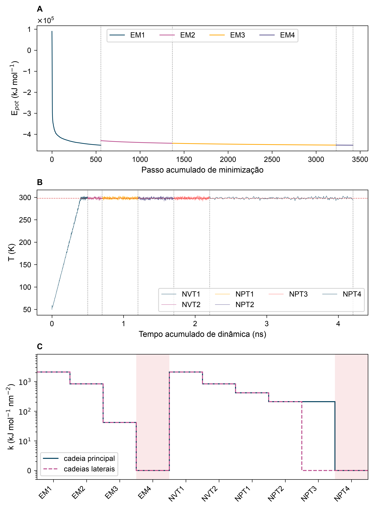
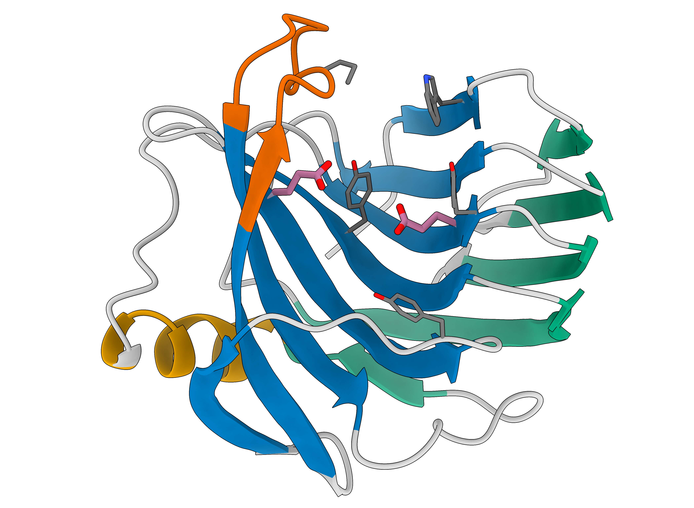
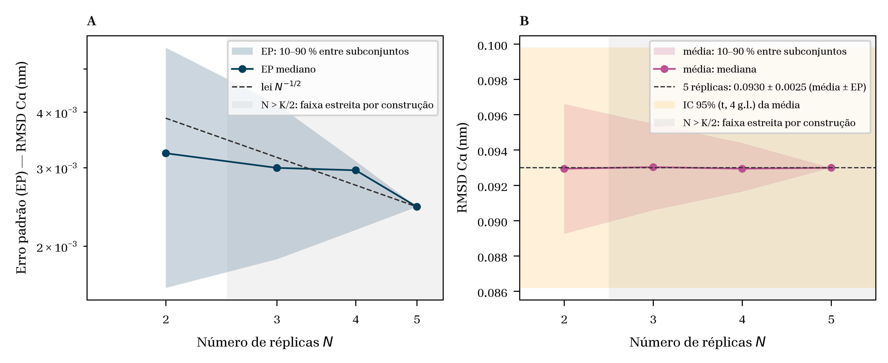
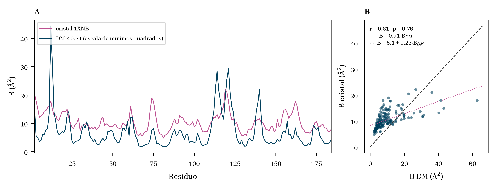
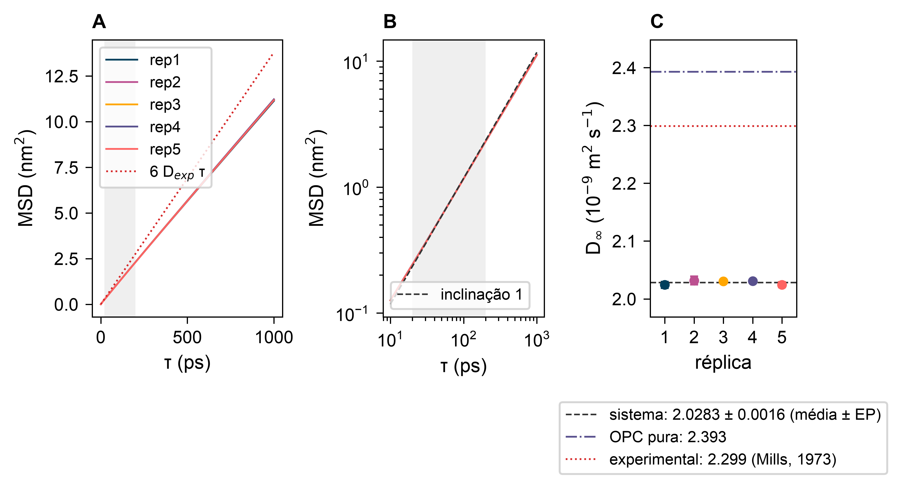

# Análises de Resultados de Dinâmica Molecular

!!! abstract "O que esperar?"
 
    A xilanase GH11 de *Bacillus circulans* (BcX, PDB 1XNB) é uma proteína pequena e rígida, enovelada em folha-β. Por isso, o esperado é uma estrutura global estável e próxima do cristal, com flexibilidade concentrada em poucas alças (sobretudo o *thumb*), e um solvente que reproduz as propriedades do modelo de água OPC. As cinco réplicas devem concordar nas médias e divergir nos eventos raros.

> Explore, colabore e estude! :lucide-smile: Dúvidas: [patrick.faustino@unesp.br](mailto:patrick.faustino@unesp.br)

Esta página analisa as cinco réplicas de 300 ns da [DM não enviesada da xilanase](md-easy.md). Antes das análises, as trajetórias passam por um [ajuste](#ajuste-da-trajetoria) que corrige a representação das condições periódicas de contorno. Os resultados estão agrupados em seis conjuntos, seguidos dos notebooks utilizados nas análises:

1. [Preparação e equilibração](#preparacao-e-equilibracao).
2. [Estacionariedade e réplicas](#estacionariedade-e-replicas).
3. [Estrutura global comparada ao cristal](#estrutura-global-comparada-ao-cristal).
4. [Flexibilidade](#flexibilidade).
5. [Sítio ativo](#sitio-ativo).
6. [Solvente](#solvente).
7. [Notebooks para análises](#notebooks-para-analises). 

---
## :lucide-route: Ajuste da trajetória

### Por que ajustar?

A simulação usa condições periódicas de contorno: a caixa é replicada infinitamente em todas as direções, e uma molécula que sai por uma face reentra pela face oposta. O GROMACS grava cada átomo dentro da caixa principal, de modo que, no arquivo `.xtc`, moléculas que cruzam uma face aparecem **quebradas** em duas partes, e a proteína pode se deslocar até ficar dividida entre lados opostos da caixa.

A dinâmica não está errada: trata-se apenas da forma como as coordenadas são representadas. Mas qualquer análise calculada sobre moléculas quebradas produz resultados espúrios. O RMSD e o raio de giração saltam para valores irreais, e distâncias entre resíduos atravessam a caixa inteira. Por isso, a trajetória é reconstruída antes de qualquer análise.

### Passo 1: reconstruir as moléculas

A opção `-pbc whole` junta as partes de cada molécula quebrada pela face da caixa:

```bash
gmx trjconv -s md_300ns.tpr -f md_300ns.xtc -o md_whole.xtc -pbc whole

# -pbc whole = reconstrói as moléculas quebradas pelas condições periódicas.
# grupo de saída: System (sistema inteiro)
```

### Passo 2: centralizar a proteína

A opção `-center` coloca a proteína no centro da caixa em cada quadro, e `-pbc mol` reposiciona as demais moléculas inteiras ao redor dela. A opção `-ur compact` representa a caixa dodecaédrica na forma mais compacta em torno da proteína, em vez da célula triclínica equivalente:

```bash
gmx trjconv -s md_300ns.tpr -f md_whole.xtc -o md_300ns_mol.xtc -pbc mol -center -ur compact

# -pbc mol = mantém cada molécula inteira, com o centro de massa dentro da caixa.
# -center = centraliza o grupo escolhido.
# -ur compact = representação compacta da célula unitária.
# grupos: Protein (centralização) / System (saída)
```

O passo 1 evita que a proteína, já quebrada no quadro de entrada, seja centralizada pelo centro de massa errado.

### Referência e demais réplicas

A estrutura minimizada (EM4), usada como referência do RMSD, recebe o mesmo tratamento, uma única vez, na pasta do sistema:

```bash
gmx trjconv -s em4.tpr -f em4.gro -o em4_mol.gro -pbc mol -center -ur compact

# grupos: Protein (centralização) / System (saída)
```

---
## :lucide-flask-conical: Preparação e equilibração

<div align="center">
    
</div>

**Figura 1.** Escada de preparação da réplica 1: minimização (A), temperatura (B) e restrições posicionais (C). No painel C, em escala logarítmica, as etapas sem restrição (k = 0) são representadas em k = 1.
 
O que a figura mostra:
 
- **Minimização:** dentro de cada etapa, a energia cai de forma monotônica, até cerca de −4,5 × 10⁵ kJ mol⁻¹, em aproximadamente 3400 passos somados. A EM4, sem restrições, converge rapidamente, o que indica que as etapas restritas já haviam removido os contatos estéricos desfavoráveis.
- **Saltos entre etapas:** a energia potencial reportada pelo GROMACS inclui o termo de restrição de posição (`Position Rest.`), que muda a cada etapa porque a constante de força cai (2100 → 800 → 40 → 0 kJ mol⁻¹ nm⁻²) enquanto as coordenadas de partida permanecem as mesmas. Parte de cada salto é, portanto, uma mudança da própria função de energia, e não do sistema. Entre EM1 e EM2, o salto de cerca de 2 × 10⁴ kJ mol⁻¹ soma a esse efeito a troca do modelo de água, flexível na EM1 (`-DFLEXIBLE`) e rígida a partir da EM2. Os saltos seguintes, de cerca de 150 kJ mol⁻¹, refletem essencialmente a redução do termo de restrição.
- **Temperatura:** acompanha a rampa sem atraso apreciável, como esperado com `gen-temp` igual ao primeiro ponto da rampa e `tau-t` de 0,5 ps, e flutua em torno de 298 K da NVT2 em diante.

O comportamento é coerente com o protocolo do tutorial, adaptado de [Roe e Brooks (2020)](https://doi.org/10.1063/5.0013849). A rampa de aquecimento é uma dessas adaptações, pois o protocolo original gera as velocidades já na temperatura-alvo. O aquecimento sem degrau inicial é o sinal, descrito na [etapa NVT1](md-easy.md#nvt1-aquecimento), de uma escolha correta de `gen-temp`.

---
## :lucide-copy: Estacionariedade e réplicas
 
### RMSD (*Root Mean Square Deviation*)
 
O RMSD mede quanto a estrutura se afasta de uma referência depois de removidas translação e rotação. É um **diagnóstico**, não um observável físico: um platô é condição necessária, mas não suficiente, de convergência [Grossfield et al., 2018](https://doi.org/10.33011/livecoms.1.1.5067). Aqui a referência é a estrutura minimizada (EM4), comum às cinco réplicas, para que as médias sejam comparáveis.

```bash
# Cα: ajuste e RMSD no mesmo grupo (escolha: C-alpha, C-alpha)
gmx rms -s em4.gro -f md_300ns_mol.xtc -o rmsd_ca.xvg -tu ns

# cadeia principal (escolha: Backbone, Backbone)
gmx rms -s em4.gro -f md_300ns_mol.xtc -o rmsd_bb.xvg -tu ns
```

A Figura 2 mostra o RMSD dos Cα e da cadeia principal ao longo dos 300 ns, com a distribuição da produção à direita.

<div align="center">
    <iframe src="../assets/plots/rmsd_series.html" width="100%" height="650px" style="border:none;" loading="lazy"></iframe>
</div>

**Figura 2.** RMSD dos Cα e da cadeia principal em relação à estrutura minimizada (5 réplicas).
 
O que a figura mostra:
 
- **Médias:** **0,0930 ± 0,0025 nm** (Cα) e **0,0908 ± 0,0024 nm** (cadeia principal). São valores baixos e estáveis desde o início da produção.
- **Eventos por réplica:** a rep5 tem excursões até ~0,15 nm (0–30, 90–110 e 140–150 ns), e a rep2 sobe depois de 250 ns. Esses eventos coincidem com os movimentos do *thumb*.
- **Distribuição:** é assimétrica à direita, o que significa que os desvios grandes são raros, mas existem.

Um RMSD abaixo de 0,1 nm é típico de proteínas pequenas e rígidas. Ele é coerente com o enovelamento β-*jellyroll* das GH11, descrito como uma "mão direita" parcialmente fechada, com palma, dedos e polegar [Paës; Berrin; Beaugrand, 2012](https://doi.org/10.1016/j.biotechadv.2011.10.003).

<div align="center">
    
</div>

> **Figura 3**. Enovelamento em “mão direita” (β-jellyroll) da xilanase GH11 de Bacillus circulans (BcX).
>
>- Palma (azul): folha β, resíduos 5–10, 35–42, 64–72, 77–85, 93–99, 104–116, 122–132 e 167–174.
>- Dedos (verde): folha β, resíduos 15–20, 26–31, 50–61, 142–145 e 177–183.
>- Hélice α (amarelo): resíduos 146–155.
>- Polegar (laranja): resíduos 111–124.
>- Alças: cinza.
>
>Os resíduos catalíticos Glu78 (nucleófilo) e Glu172 (ácido/base) estão em bastões, com carbonos rosa. Os resíduos que delimitam a fenda (Trp9, Tyr69, Tyr88, Pro116 e Tyr174) estão em bastões finos, com carbonos cinza. Paleta Okabe-Ito (Wong, 2011). Figura gerada no UCSF ChimeraX (Pettersen et al., 2021).

### Quantas réplicas são necessárias?
 
A dinâmica molecular é caótica: duas simulações que partem da mesma estrutura, mas com velocidades iniciais diferentes (sementes diferentes), divergem rapidamente e percorrem regiões distintas do espaço conformacional. Uma única trajetória, por mais longa que seja, mostra apenas um desses caminhos e não permite estimar a própria incerteza ([Knapp; Ospina; Deane, 2018](https://doi.org/10.1021/acs.jctc.8b00391); [Wan; Sinclair; Coveney, 2021](https://doi.org/10.1098/rsta.2020.0082)). Com várias réplicas independentes, cada uma funciona como uma medida, e a dispersão entre elas fornece estimadores de erro.

<div align="center">
    
</div>

**Figura 4.** Convergência da média do RMSD em função do número de réplicas (N). Na faixa cinza (N ≥ 3), as combinações necessariamente compartilham réplicas e deixam de ser independentes entre si; em N = 5 existe uma única combinação.

- **A média converge cedo.** Já com N = 2, a mediana das médias das combinações coincide com a média das cinco réplicas. Para uma grandeza global como o RMSD, poucas réplicas já fornecem a média correta.
- **O erro cai com a raiz quadrada de N.** O erro padrão da média (EP) é EP = *s*/√N, em que *s* é o desvio-padrão entre as réplicas. Na figura, o EP acompanha a curva N⁻¹ᐟ², como esperado para medidas independentes. Na prática, para reduzir o erro pela metade são necessárias **quatro vezes** mais réplicas.
- **Com poucas réplicas, o intervalo de confiança é bem maior que o EP.** O intervalo de confiança de 95 % (IC 95 %) é EP × *t*, em que *t* vem da distribuição *t* de Student e é grande quando N é pequeno. Com as cinco réplicas, EP = 0,0025 nm e *t* = 2,78, de modo que o IC 95 % é ±0,007 nm, quase três vezes o EP.

Para médias globais, cinco réplicas são suficientes e coerentes com a recomendação de Knapp et al. (2018) e com o argumento de Wan et al. (2021). O ganho de cada réplica adicional está em outro aspecto: a chance de observar **eventos raros**, como a abertura do polegar e a deriva da rep4, discutidas nas seções seguintes.

---
## :lucide-box: Estrutura global comparada ao cristal
 
### Raio de giração e forma
 
O raio de giração (Rg) mede a compactação global e é invariante à rotação. Os autovalores do tensor de giração dão descritores de forma [Theodorou; Suter, 1985](https://doi.org/10.1021/ma00149a018): a anisotropia relativa κ² vale 0 numa esfera e 1 num bastão.

```bash
gmx gyrate -s md_300ns.tpr -f md_300ns_mol.xtc -sel Protein -mode mass -o rg.xvg -tu ns

# cristal, mesmo cálculo (saída do pdb2gmx)
gmx gyrate -s xilanase.gro -f xilanase.gro -sel Protein -mode mass -o rg_cristal.xvg -tu ns
```

A Figura 5 mostra o Rg, a asfericidade *b*, a acilindricidade *c* e κ² ao longo da produção, com a linha do cristal.

<div align="center">
    <iframe src="../assets/plots/rg_series.html" width="100%" height="920px" style="border:none;" loading="lazy"></iframe>
</div>

**Figura 5.** Raio de giração e descritores de forma (5 réplicas). Linha pontilhada: o mesmo cálculo no cristal 1XNB.
 
| Grandeza | DM (média ± EP) | Cristal 1XNB | Diferença |
|---|---|---|---|
| Rg | 1,5146 ± 0,0011 nm | ≈ 1,491 nm | +1,6 % |
| κ² | 0,023 | menor | proteína quase esférica nos dois casos |
 
O que a figura e a tabela mostram:
 
- **Compactação:** a proteína se mantém compacta e quase esférica (κ² ≈ 0,02).
- **Um pouco mais expandida que no cristal:** o Rg fica 1,6 % acima, e *b*, *c* e κ² também.
- **Eventos coincidentes:** os picos da rep5 e a queda da rep4 em ~235 ns (Rg ≈ 1,49 nm) coincidem com os eventos do RMSD e do polegar.

A diferença com o cristal tem leitura física: em solução e sem contatos de rede, o polegar fica mais aberto.

### Área superficial acessível ao solvente (SASA)
 
A SASA é a área que uma sonda do tamanho de uma água (raio de 0,14 nm) consegue tocar [Shrake; Rupley, 1973](https://doi.org/10.1016/0022-2836(73)90011-9). Separada em parte polar (N, O) e apolar (C, S), ela indica quanto da superfície hidrofóbica está exposta, um indicador precoce de perda da estrutura terciária.

```bash
gmx sasa -s md_300ns.tpr -f md_300ns_mol.xtc -o sasa.xvg -tu ns \
         -surface 'group Protein' \
         -output 'group Protein and (element C or element S)' 'group Protein and (element N or element O)'

# cristal
gmx sasa -s xilanase.gro -f xilanase.gro -o sasa_cristal.xvg -surface 'group Protein'
```

A Figura 6 mostra a SASA total, polar e apolar ao longo da produção, com a linha do cristal.

<div align="center">
    <iframe src="../assets/plots/sasa_series.html" width="100%" height="900px" style="border:none;" loading="lazy"></iframe>
</div>

**Figura 6.** SASA total, polar e apolar (5 réplicas, raios de Bondi, sonda de 0,14 nm). Linha pontilhada: o mesmo cálculo no cristal 1XNB.
 
| SASA | DM (média ± EP) | Cristal 1XNB | Diferença |
|---|---|---|---|
| Total | 83,31 ± 0,14 nm² | ≈ 79,9 nm² | +4 % |
| Polar | 42,50 nm² | ≈ 43,6 nm² | −3 % |
| Apolar | 40,80 nm² | ≈ 36,4 nm² | **+12 %** |
 
O que a figura e a tabela mostram:
 
- **Estacionária:** a SASA não deriva na produção, e a soma polar + apolar fecha com a total.
- **Mesma queda da rep4:** em ~235 ns, a total cai para ~79 nm².
- **Diferença concentrada na parte apolar:** a SASA total fica 4 % acima do cristal, e quase toda a diferença está na superfície apolar.

Em solução, a BcX expõe mais superfície hidrofóbica que no cristal. A fenda catalítica das GH11 é revestida de resíduos aromáticos que ligam o xilano (Paës; Berrin; Beaugrand, 2012), e o polegar mais aberto expõe parte deles. Por isso o aumento apolar é coerente com uma fenda mais aberta, e não com desenovelamento: a estrutura secundária se mantém.

### Estrutura secundária (DSSP)
 
O DSSP atribui a cada resíduo, em cada quadro, um de oito estados de estrutura secundária a partir do padrão de ligações de hidrogênio da cadeia principal [Kabsch; Sander, 1983](https://doi.org/10.1002/bip.360221211). Comparado ao cristal, ele responde se o enovelamento se mantém resíduo a resíduo.

```bash
gmx dssp -s md_300ns.tpr -f md_300ns_mol.xtc -sel Protein -o dssp.dat -num dssp_num.xvg -tu ns -hmode dssp
```

A Figura 7 mostra três séries ao longo do tempo: a fração de folha-β, a de hélice e a concordância com o cristal (fração de resíduos no mesmo estado do 1XNB). A Figura 8 mostra, para cada resíduo, o estado em cada instante.
 
<div align="center">
    <iframe src="../assets/plots/dssp_series.html" width="100%" height="760px" style="border:none;" loading="lazy"></iframe>
</div>

**Figura 7.** Folha-β, hélice e concordância com o cristal 1XNB (5 réplicas).

<div align="center">
    <iframe src="../assets/plots/dssp_residuo_tempo.html" width="100%" height="460px" style="border:none;" loading="lazy"></iframe>
</div>

**Figura 8.** Mapa resíduo × tempo da estrutura secundária.

| Grandeza | DM (média ± EP) |
|---|---|
| Concordância com o cristal | 94,0 ± 0,5 % |
| Folha-β | 62,1 % |
| Hélice | 5,15 % (a única hélice α das GH11) |
 
O que as figuras e a tabela mostram:
 
- **Conservação:** em média, 94 % dos resíduos ficam no mesmo estado do cristal, e o conteúdo de folha-β e de hélice é estável.
- **Perdas locais:** só os resíduos 32–33, 62–63 e 175–176 passam menos da metade do tempo no estado do cristal.

O enovelamento β-*jellyroll*, com uma única hélice α sob a palma, é a assinatura das GH11 (Paës; Berrin; Beaugrand, 2012), e a simulação o preserva. A deriva lenta da rep4 é o tipo de evento que só aparece com réplicas: numa trajetória única com aquela semente, a conclusão seria "perda parcial de folha-β"; nas outras quatro, não há perda (Knapp; Ospina; Deane, 2018).

---
## :lucide-activity: Flexibilidade
 
### RMSF por resíduo
 
O RMSF mede quanto cada resíduo flutua em torno da própria posição média. Diferentemente do RMSD, é um **perfil** ao longo da cadeia, não uma série temporal. Cada réplica foi alinhada à própria estrutura média, porque alinhar a um quadro instantâneo infla o RMSF de forma sistemática.

```bash
# escolha: C-alpha
gmx rmsf -s md_300ns.tpr -f md_300ns_mol.xtc -o rmsf_ca.xvg -res -oq bfator.pdb -ox media.pdb
```

A Figura 9 mostra o RMSF dos Cα:
 
- a média das cinco réplicas, com faixa ± EP;
- as réplicas individuais;
- a estrutura secundária ao fundo;
- os picos que passam da triagem (média + 1,5 σ entre resíduos).

<div align="center">
    <iframe src="../assets/plots/rmsf_perfil.html" width="100%" height="520px" style="border:none;" loading="lazy"></iframe>
</div>

**Figura 9.** RMSF dos Cα (5 réplicas). Faixa: ± EP entre réplicas; fundo: hélice (azul) e folha-β (amarelo).
 
O que a figura mostra:
 
- **Picos comuns:** Gly12, Asn114 e Asp121 (as duas últimas na região do polegar) e Ser140 aparecem nas cinco réplicas.
- **Picos de uma réplica só:** a rep4 tem flexibilidade em 55–62, e a rep5 eleva o pico da Ser140 a 0,157 nm.
- **Onde a faixa ± EP se alarga:** justamente nessas regiões, onde as réplicas discordam.

Os picos ficam nas alças e no polegar, e as fitas β do núcleo são rígidas, o padrão esperado para as GH11 (Muilu et al., 1998; Paës; Berrin; Beaugrand, 2012). Os picos de uma réplica só ilustram o argumento central de Wan et al. (2021): conclusões sobre regiões específicas exigem várias réplicas.

### Comparação com o fator B cristalográfico
 
O fator B é a única medida experimental de flutuação por átomo vinda do cristal. A relação B = (8π²/3)·RMSF² converte o RMSF em um "B equivalente". A comparação é de **forma**, não de valor: o B contém desordem estática e movimentos da rede que a DM em solução não tem [Kuzmanic; Pannu; Zagrovic, 2014](https://doi.org/10.1038/ncomms4220).
 
A Figura 10 mostra dois painéis:
 
- **A**, os perfis de B da DM (multiplicado pelo fator de escala) e do cristal;
- **B**, a dispersão resíduo a resíduo, com a regressão.


<div align="center">
    
</div>

**Figura 10.** Fator B equivalente da DM × fator B dos Cα do 1XNB.
 
| Medida | Valor | Leitura |
|---|---|---|
| Pearson *r* | 0,61 | concordância linear moderada |
| Spearman ρ | 0,76 | o **ordenamento** dos resíduos é bem reproduzido |
| Escala de mínimos quadrados (pela origem) | 0,71 | só coloca os perfis na mesma escala; sem significado físico |
| Regressão B<sub>cristal</sub> = *a* + *b*·B<sub>DM</sub> | *a* = 8,1 Ų, *b* = 0,23 | *a*: parte do B que a DM não descreve; *b*: inclinação, atenuada pela correlação imperfeita |
 
Como interpretar a tabela:
 
- **Spearman maior que Pearson:** a DM ordena bem os resíduos do mais rígido ao mais móvel. Poucos resíduos muito flexíveis (Gly12, polegar) achatam a correlação linear.
- **Intercepto de ~8 Ų:** é o piso de desordem estática e de vibração da rede, ausente na simulação.
- **Inclinação de 0,23:** a inclinação de mínimos quadrados é *b* = *r* · σ<sub>cristal</sub>/σ<sub>DM</sub>. Com *r* = 0,61, ela é atenuada pela correlação imperfeita entre os perfis (diluição da regressão) e não deve ser lida como a fração da flutuação da DM que aparece no cristal. O valor baixo indica que as amplitudes da DM variam mais entre resíduos do que as do cristal, sobretudo nas alças, coerente com a restrição imposta pelos contatos de rede, mas não quantifica essa restrição.

Correlações de 0,5 a 0,8 entre RMSF e B são o resultado usual. Kuzmanic et al. (2014) mostraram que o refinamento cristalográfico subestima a heterogeneidade real e mistura desordem estática ao B. Por isso o perfil é o que se compara, e os valores absolutos não.

### Parâmetros de ordem S² (RMN)
 
O parâmetro de ordem S² de cada ligação N–H mede, de 0 a 1, o quanto ela está restrita: S² = 1 corresponde a uma ligação rígida, e S² = 0, a um movimento isotrópico irrestrito (Lipari; Szabo, 1982). Medido por relaxação de ¹⁵N em solução, é a comparação experimental **mais direta** para a flexibilidade da cadeia principal em DM. Ao contrário do fator B, refere-se ao mesmo estado físico da simulação: a proteína em solução.
 
A Figura 11 mostra o S² por resíduo, média das réplicas ± EP. O cálculo foi feito em blocos de ~10 ns, próximos do tempo de correlação rotacional medido para a BcX (τm = 9,2 ± 0,2 ns; Connelly; Withers; McIntosh, 2000), e então promediado. Movimentos mais lentos que τm não contribuem para o S² obtido por relaxação de ¹⁵N e, por isso, são excluídos (Maragakis et al., 2008).
 
<div align="center">
    <iframe src="../assets/plots/s2_perfil.html" width="100%" height="440px" style="border:none;" loading="lazy"></iframe>
</div>

**Figura 11.** Parâmetro de ordem S² das ligações N–H da cadeia principal (5 réplicas, blocos de ~τm).
 
| Grandeza | DM | RMN (Connelly et al., 2000) |
|---|---|---|
| S² médio da cadeia principal | 0,853 ± 0,001 | 0,86 ± 0,04 |
| τm usado no bloco | ~10 ns | 9,2 ± 0,2 ns |
 
O que a figura e a tabela mostram:
 
- **Média:** a DM concorda com a RMN dentro da dispersão experimental.
- **Quedas:** os resíduos 12, 21, 62, 88, 96 e 140 têm S² mais baixo e coincidem com os picos de RMSF.

Esta é a validação mais direta da flexibilidade, porque compara a simulação com um experimento em solução. A concordância da média, contudo, é um teste pouco exigente; a comparação resíduo a resíduo com os S² depositados (quando disponíveis no BMRB) seria o próximo passo.

### O polegar (*thumb*)
 
Nas GH11, o polegar é uma alça em grampo que se fecha sobre a fenda catalítica. Sua abertura e seu fechamento são associados à entrada do substrato e à saída do produto (Muilu et al., 1998; Paës; Berrin; Beaugrand, 2012). Por isso ele é o candidato natural ao movimento que domina os eventos vistos nas seções anteriores.
 
A Figura 12 mostra a distância Asp11–Pro116, entre a ponta do polegar e a palma, e o RMSD local do polegar.
 
<div align="center">
    <iframe src="../assets/plots/polegar_series.html" width="100%" height="620px" style="border:none;" loading="lazy"></iframe>
</div>

**Figura 12.** Abertura do polegar (distância Asp11–Pro116) e RMSD local do polegar (5 réplicas). Linha pontilhada: cristal 1XNB.
 
| Grandeza | DM (média ± EP) | Cristal 1XNB |
|---|---|---|
| Distância Asp11–Pro116 | 1,212 ± 0,016 nm | 0,90 nm |
| RMSD local do polegar | 0,206 nm | — |
 
O que a figura e a tabela mostram:
 
- **Mais aberto que no cristal:** em média, cerca de 3 Å, nas cinco réplicas.
- **Eventos próprios de cada réplica:** rep5 abre até 1,6 nm em ~95 ns; rep3 fecha entre 60 e 90 ns; rep4 fecha em ~235 ns, o mesmo instante da queda do Rg e da SASA.

O polegar está associado às variações observadas nos demais conjuntos: RMSD, Rg, κ², SASA e RMSF variam simultaneamente com ele. A diferença em relação ao cristal é coerente com a literatura: simulações de GH11 mostram o polegar oscilando entre conformações abertas e fechadas em solução (Muilu et al., 1998). O cristal registra uma conformação fechada, possivelmente estabilizada pelos contatos de rede.

---
## :lucide-scissors: Sítio ativo
 
### Distância entre os carboxilatos catalíticos
 
A BcX hidrolisa o xilano por um mecanismo de **retenção** com dois glutamatos:
 
- **Glu78**, o nucleófilo (pKa 4,6);
- **Glu172**, o ácido/base geral (pKa 6,7) (McIntosh et al., 1996).

Em glicosidases de retenção, os dois resíduos catalíticos ficam tipicamente a cerca de 5,5 Å um do outro; nas de inversão, a 6–11 Å, distância que acomoda a molécula de água nucleofílica entre eles [McCarter; Withers, 1994; Davies; Henrissat, 1995](https://doi.org/10.1016/0959-440x(94)90271-2). As fontes consultadas não especificam entre quais átomos a distância é medida. Por isso, o valor de referência é usado aqui como ordem de grandeza, e a comparação quantitativa é feita com o cristal 1XNB. Manter essa geometria é um teste funcional da simulação.

```bash
# CD–CD entre os glutamatos catalíticos
gmx distance -s md_300ns.tpr -f md_300ns_mol.xtc -oall glu_cd.xvg -tu ns \
             -select 'resnr 78 and name CD plus resnr 172 and name CD'

# menor distância O–O entre os carboxilatos
gmx pairdist -s md_300ns.tpr -f md_300ns_mol.xtc -o glu_oo.xvg -tu ns \
             -ref 'resnr 78 and name OE1 OE2' -sel 'resnr 172 and name OE1 OE2'
```

A Figura 13 mostra duas distâncias ao longo da produção: CD–CD entre os dois glutamatos e a menor distância O–O entre os carboxilatos.
 
<div align="center">
    <iframe src="../assets/plots/carboxilatos_series.html" width="100%" height="620px" style="border:none;" loading="lazy"></iframe>
</div>

**Figura 13.** Distâncias Glu78–Glu172 (5 réplicas). Linha pontilhada: cristal 1XNB.
 
| Distância | DM (média ± EP) | Cristal 1XNB |
|---|---|---|
| CD–CD | 0,791 ± 0,014 nm | 0,651 nm |
| O–O mínima | 0,661 nm | 0,529 nm |

Referência da literatura para enzimas de retenção: ≈ 0,55 nm entre os resíduos catalíticos, sem definição dos átomos. Os dois valores do cristal (0,53 e 0,65 nm) ficam em torno dela.
 
O que a figura e a tabela mostram:
 
- **Desvio sistemático:** a distância fica cerca de 1,3 Å acima do cristal nas **cinco** réplicas.
- **Abertura transitória:** a rep2 abre até ~1,0 nm entre 190 e 245 ns.

O afastamento não é um evento raro, e sim um desvio sistemático do estado simulado. Os estados de protonação adotados (pH 5,7) e a preparação da estrutura restringem as explicações possíveis:

- **Ausência das águas cristalográficas:** o PDB preparado para a simulação não contém as águas do cristal. As águas que ocupam a fenda catalítica no 1XNB são substituídas pelo solvente adicionado com o `gmx solvate`, que não reproduz necessariamente a rede de ligações de hidrogênio do cristal entre os carboxilatos e os resíduos vizinhos. Essa é a hipótese mais diretamente ligada ao protocolo, e pode ser testada com a contagem de águas a menos de 0,35 nm dos dois carboxilatos e com uma simulação que mantenha as águas cristalográficas do sítio.
- **Ausência do substrato:** na enzima apo, nenhum ligante ocupa a fenda e organiza a geometria dos resíduos catalíticos; a conformação do cristal pode não representar o mínimo da enzima livre em solução.
- **Estados de protonação:** o Glu78 foi simulado desprotonado (GLU, pKa 4,6) e o Glu172 protonado (GLH, pKa 6,7), conforme McIntosh et al. (1996). Como o Glu172 é neutro, a repulsão eletrostática direta entre os dois carboxilatos é pequena e dificilmente explica o afastamento. Os estados, porém, são fixos: a DM clássica não permite que o próton do Glu172 se ajuste à geometria do sítio, e um estado diferente do cristal favoreceria outra orientação da cadeia lateral.
- **Coordenação por íons:** um Na⁺ coordenado ao carboxilato do Glu78, o único carregado, poderia deslocá-lo. A hipótese é verificável pela distância Na⁺–O<sub>ε</sub> do Glu78 (coordenação típica abaixo de 0,3 nm) ao longo das réplicas.

---
## :lucide-droplets: Solvente

### Estrutura da água no sistema: RDF O–O
 
A função de distribuição radial g em função da distância mede a probabilidade de encontrar um átomo a uma distância *r* de outro, relativa a um fluido sem estrutura. Para a água, o primeiro pico de g<sub>OO</sub> é a camada de ligações de hidrogênio. Para não confundir o efeito da proteína com o do modelo, só entram como referência as águas a mais de 1,5 nm de qualquer átomo pesado da proteína, em cada quadro (água de *bulk*).

```bash
gmx rdf -s md_300ns.tpr -f md_300ns_mol.xtc -o rdf_bulk.xvg -cn cn_bulk.xvg \
        -ref 'name OW and not within 1.5 of (group Protein and not element H)' \
        -sel 'name OW'
```

A Figura 14 apresenta três elementos de comparação:
 
- a g<sub>OO</sub> em função da distância, da água de *bulk* do sistema;
- o número de coordenação acumulado;
- a sobreposição com a OPC pura e com o experimento.

<div align="center">
    <iframe src="../assets/plots/rdf.html" width="100%" height="520px" style="border:none;" loading="lazy"></iframe>
</div>

**Figura 14.** g<sub>OO</sub> da água de *bulk* do sistema (5 réplicas), comparada à caixa de OPC pura e à difração de raios X (Skinner et al., 2013).
 
O que a figura mostra:
 
- **Coincide com a OPC pura:** a água de *bulk* do sistema reproduz a curva da caixa pura: pico em 0,281 nm, altura ≈ 3,2 e cauda que tende a 1 (0,994 a 1 nm).
- **Mesmos desvios da OPC pura em relação ao experimento:** a posição do pico é correta e a altura é superestimada.

A coincidência com a OPC pura indica que a análise é consistente e que o pico elevado é uma propriedade do **modelo**, não da proteína nem de um erro de normalização. A difração de Skinner et al. (2013) é a referência experimental, mas o termo de comparação adequado para a água do sistema é a caixa pura do mesmo modelo.
 
### Difusão da água no sistema
 
O coeficiente de difusão é a principal propriedade de transporte da água. A proteína o reduz, porque as águas da camada de hidratação são mais lentas que as do *bulk*.

```bash
# trajetória sem saltos de PBC (escolha: System)
gmx trjconv -s md_300ns.tpr -f md_300ns.xtc -o md_nojump.xtc -pbc nojump

gmx msd -s md_300ns.tpr -f md_nojump.xtc -sel 'name OW' -o msd_agua.xvg \
        -trestart 100 -beginfit 500 -endfit 5000 -maxtau 10000
```

A Figura 15 mostra três painéis:
 
- **A**, o MSD das águas;
- **B**, a inclinação em escala log-log, que confirma o regime difusivo (inclinação = 1) na janela de ajuste;
- **C**, o D<sub>∞</sub> de cada réplica comparado às referências.

<div align="center">
    
</div>

**Figura 15.** Difusão da água no sistema: MSD, regime difusivo e D<sub>∞</sub> (correção de Yeh–Hummer) comparado à OPC pura e ao experimento.
 
| Comparação | Razão | O que mede |
|---|---|---|
| OPC pura / experimento | 1,04 | o erro do modelo de água |
| Sistema / OPC pura | 0,85 | o efeito da proteína (D<sub>sistema</sub> ≈ 2,0 × 10⁻⁹ m² s⁻¹) |
 
O que a figura e a tabela mostram:
 
- **Regime difusivo:** confirmado na janela de ajuste.
- **Mais lenta que a água pura:** a água do sistema difunde 15 % menos que a OPC pura.
- **Duas razões, dois efeitos:** separadas, elas distinguem o que é do modelo (+4 %) do que é da presença da proteína e dos íons (−15 %).

A redução é coerente com a água de hidratação, que difunde mais devagar que o *bulk*, e com o efeito do NaCl. Uma análise por camadas (água a menos de 0,35 nm da proteína × *bulk*) localizaria a origem dos 15 %.

---
## :lucide-code: Notebooks para análises

[](https://colab.research.google.com/github/patrickallanfaustino/patrickallanfaustino.github.io/blob/main/docs/assets/notebooks/analises/01_etapas_equilibracao.ipynb) [Preparação e equilibração](../assets/notebooks/analises/01_etapas_equilibracao.ipynb)

[](https://colab.research.google.com/github/patrickallanfaustino/patrickallanfaustino.github.io/blob/main/docs/assets/notebooks/analises/03_rmsd.ipynb) [RMSD](../assets/notebooks/analises/03_rmsd.ipynb) 

[](https://colab.research.google.com/github/patrickallanfaustino/patrickallanfaustino.github.io/blob/main/docs/assets/notebooks/analises/04_rg.ipynb) [Rg](../assets/notebooks/analises/04_rg.ipynb)

[](https://colab.research.google.com/github/patrickallanfaustino/patrickallanfaustino.github.io/blob/main/docs/assets/notebooks/analises/05_sasa.ipynb) [SASA](../assets/notebooks/analises/05_sasa.ipynb)

[](https://colab.research.google.com/github/patrickallanfaustino/patrickallanfaustino.github.io/blob/main/docs/assets/notebooks/analises/06_rmsf.ipynb) [RMSF](../assets/notebooks/analises/06_rmsf.ipynb)

[](https://colab.research.google.com/github/patrickallanfaustino/patrickallanfaustino.github.io/blob/main/docs/assets/notebooks/analises/07_rdf.ipynb) [RDF](../assets/notebooks/analises/07_rdf.ipynb)

[](https://colab.research.google.com/github/patrickallanfaustino/patrickallanfaustino.github.io/blob/main/docs/assets/notebooks/analises/08_convergencia_replicas.ipynb) [Convergência de réplicas](../assets/notebooks/analises/08_convergencia_replicas.ipynb)


[](https://colab.research.google.com/github/patrickallanfaustino/patrickallanfaustino.github.io/blob/main/docs/assets/notebooks/analises/09_carboxilatos_cataliticos.ipynb) [Carboxilatos catalíticos](../assets/notebooks/analises/09_carboxilatos_cataliticos.ipynb)

[](https://colab.research.google.com/github/patrickallanfaustino/patrickallanfaustino.github.io/blob/main/docs/assets/notebooks/analises/10_parametros_ordem_s2.ipynb) [Parâmetros de ordem S²](../assets/notebooks/analises/10_parametros_ordem_s2.ipynb)

[](https://colab.research.google.com/github/patrickallanfaustino/patrickallanfaustino.github.io/blob/main/docs/assets/notebooks/analises/11_difusao_agua.ipynb) [Difusão da água](../assets/notebooks/analises/11_difusao_agua.ipynb)

[](https://colab.research.google.com/github/patrickallanfaustino/patrickallanfaustino.github.io/blob/main/docs/assets/notebooks/analises/12_dssp_cristal.ipynb) [DSSP](../assets/notebooks/analises/12_dssp_cristal.ipynb)

[](https://colab.research.google.com/github/patrickallanfaustino/patrickallanfaustino.github.io/blob/main/docs/assets/notebooks/analises/13_polegar.ipynb) [Polegar](../assets/notebooks/analises/13_polegar.ipynb)

[](https://colab.research.google.com/github/patrickallanfaustino/patrickallanfaustino.github.io/blob/main/docs/assets/notebooks/analises/14_caixa_agua.ipynb) [Caixa de água](../assets/notebooks/analises/14_caixa_agua.ipynb)

---
## :lucide-quote: Como citar

FAUSTINO, P. A. S. *Documentação sobre Química Biofísica Computacional*. [S. l.]: Zenodo, 2026. DOI 10.5281/zenodo.22729510. Disponível em: <https://doi.org/10.5281/zenodo.22729510>.
