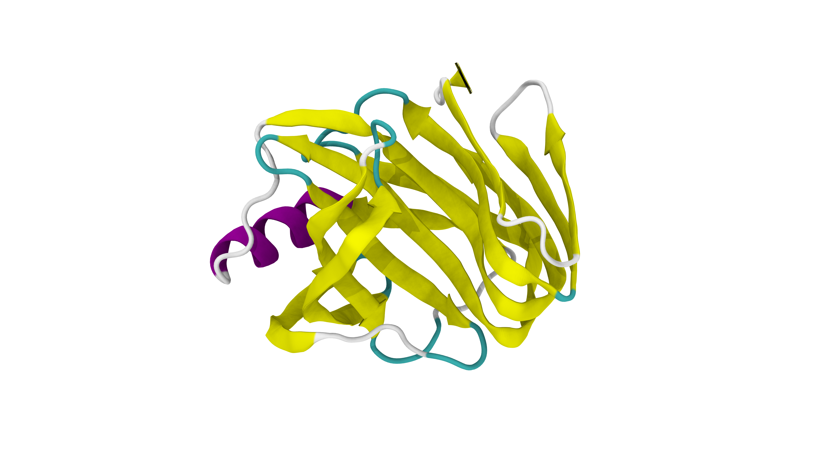
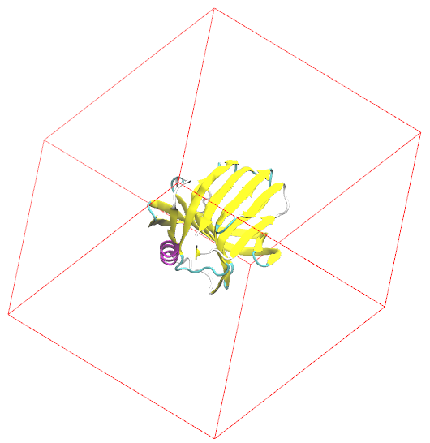
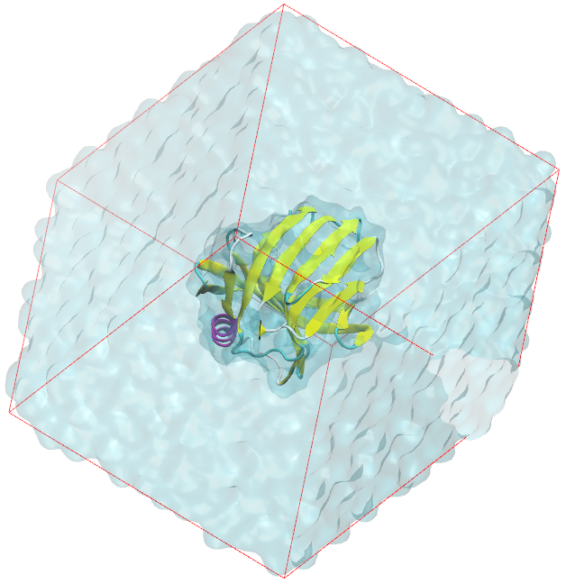
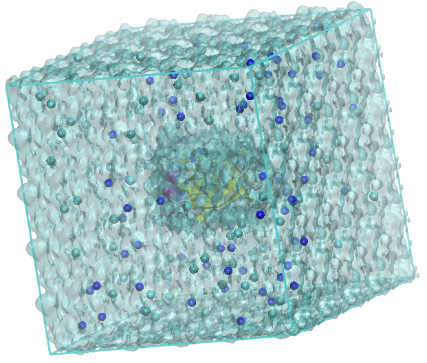
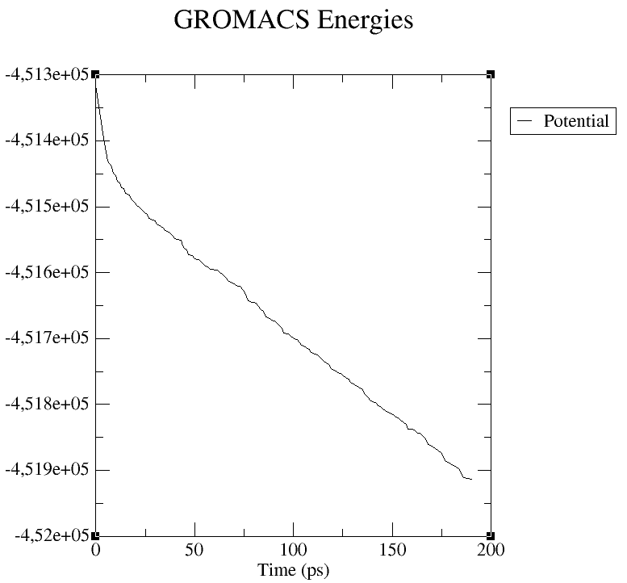
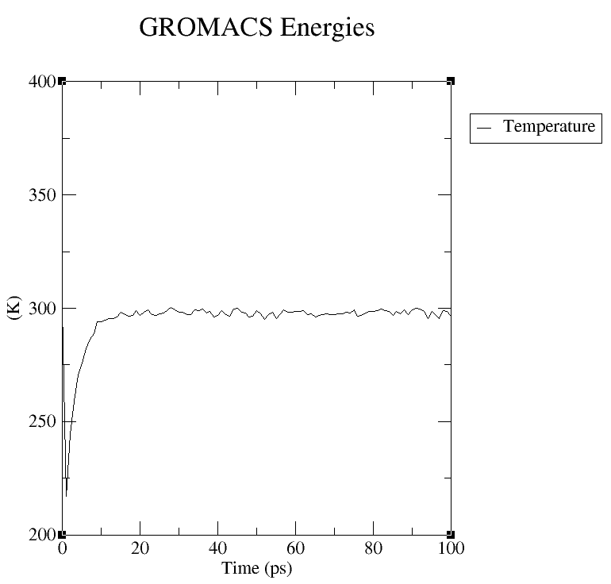
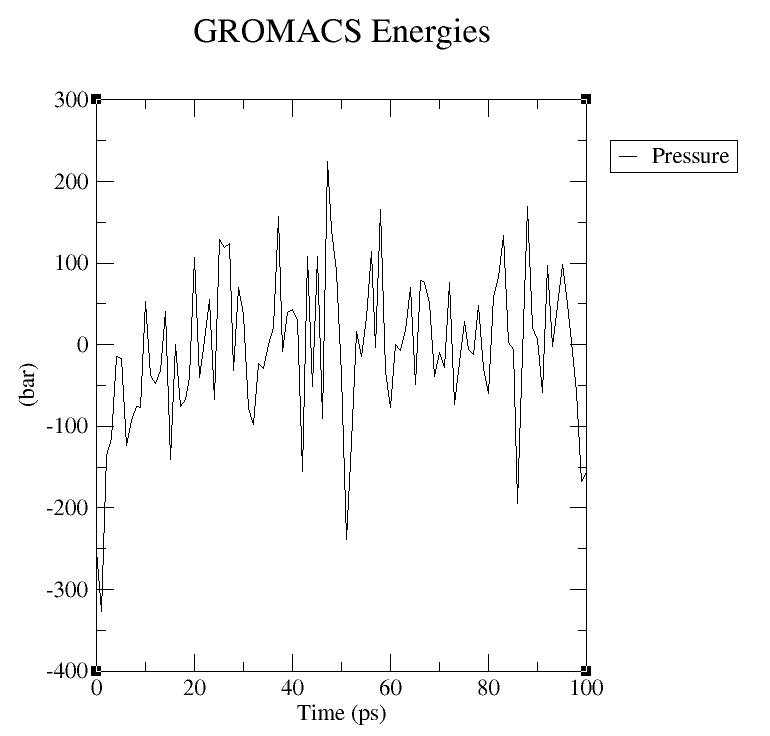
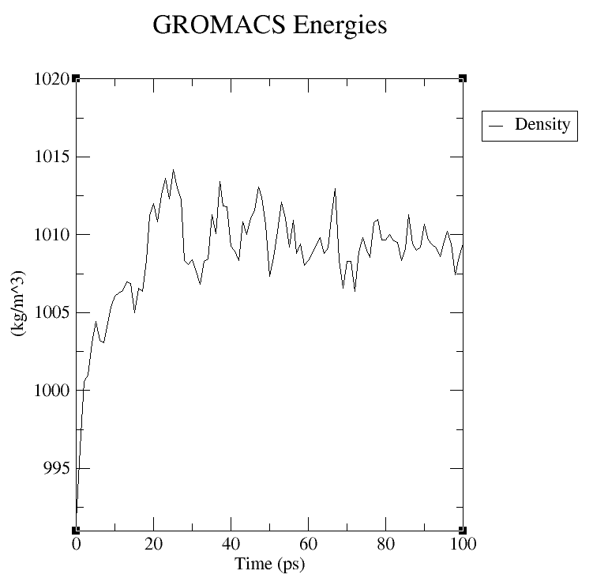

# Dinâmica Molecular Clássica de uma biomolécula em água

!!! warning "Atenção!"
    Página em reformulação.

O objetivo é simular uma biomolécula em uma caixa periódica com água a 298,15 K e 1 bar, sem viés — e terminar com um resultado que você consiga defender.

Três decisões separam uma trajetória que roda de uma que significa alguma coisa:

1. **Como preparar o sistema?**. Não em três etapas, mas em dez, liberando os graus de liberdade na ordem em que eles relaxam.
2. **Como saber que a equilibração terminou?**. Com um teste numérico, não olhando o formato da curva de densidade.
3. **Quantas vezes simular?**. Uma trajetória não permite estimar a própria incerteza, por mais longa que seja.

!!! info "Por que dez etapas?"

    * O solvente reorganiza-se em picossegundos. Cadeias laterais levam centenas de picossegundos. Estrutura secundária, nanossegundos.

    * Retirar todas as restrições ao mesmo tempo faz o calor liberado ao relaxar um contato estérico se dissipar deformando a vizinhança. A restrição escalar resolve isso prendendo o que é lento enquanto o rápido relaxa, e afrouxando por degraus.

    * O custo é na ordem de unidades de ns por réplica — irrelevante frente a uma produção de centenas de nanossegundos.


Explore, colabore e estude! :lucide-smile: Dúvidas: [patrick.faustino@unesp.br](mailto:patrick.faustino@unesp.br)

---
## :lucide-download: Arquivos iniciais

Utilize a estrutura da **Xilanase** com o código [1XNB](https://www.rcsb.org/structure/1XNB) do PDB com resolução de 1,49 Å. **Dê preferência para estruturas com resolução cristalográfica inferior a 2,5 Å**, pois isso garante uma geometria molecular mais confiável e detalhada, o que é fundamental para a qualidade da simulação. Você também pode obter estruturas do [AlphaFold](https://alphafold.ebi.ac.uk/).

A preparação rigorosa de uma estrutura cristalográfica é uma etapa crítica antes de simulações ou docagem, onde a reconstrução de resíduos faltantes — utilizando bibliotecas robustas como o [Modeller](https://salilab.org/modeller/) ou servidores web rápidos como o [SWISS-MODEL](https://swissmodel.expasy.org/) — é essencial para evitar o colapso do modelo e garantir a integridade física da cadeia polipeptídica.

Paralelamente, o ajuste do estado de protonação dos aminoácidos pode ser feito pelo servidor [H++](http://newbiophysics.cs.vt.edu/H++/) ou por ferramentas de linha de comando como [PROPKA](https://github.com/jensengroup/propka). Ignorar essa etapa resulta em atribuições de cargas elétricas erradas, o que distorce completamente as interações eletrostáticas, a formação de pontes de hidrogênio e a estabilidade conformacional de todo o sistema durante o estudo computacional.

!!! note "Dica:"
    Desenvolvi um notebook para fazer os ajustes necessários na molécula. Faça o download dos arquivos e configure corretamente o notebook.
    Download [aqui](../assets/notebooks/protein_builder.ipynb) ou [](https://colab.research.google.com/github/patrickallanfaustino/patrickallanfaustino.github.io/blob/main/docs/assets/notebooks/protein_builder.ipynb)

<div align="center">
    
</div>

>Xilanase, 1XNB. O VMD (*Visual Molecular Dynamics*) possui esquema de cores para estruturas de biomoléculas: 🟣 violeta para alfa-hélices; 🟡 amarelo para beta-folhas; 🔵 azul para Hélices 3-10; 🔵 ciano para voltas e ⚪ branco para novelos ou cordas.


---
## :lucide-atom: Preparo da topologia da molécula: campos de forças

O arquivo **1XNB.pdb** contém as coordenadas da biomolécula, moléculas de água (`HOH`) e outros ligantes (`HETATM`). Remova esses componentes extras para evitar erros nas etapas subsequentes. Realizamos essa limpeza de duas maneiras: editando o arquivo manualmente ou utilizando os comandos de terminal apresentados a seguir.

```bash
grep -v HETATM 1XNB.pdb > 1XNB_clean.pdb    # para remover todos os ligantes + água

grep -v HOH 1XNB.pdb > 1XNB_clean.pdb    # remove apenas água
```

Observe que algumas biomoléculas apresenta múltiplas cadeias, identificadas como `chain A`, `chain B`, e assim por diante. Defina uma cadeia para os estudos.

Depois de limpar o arquivo PDB, faça o ajuste dos estados de protonação dos resíduos de aminoácidos, garantindo que a biomolécula esteja em um estado de carga adequado para simulação.

Em seguida, escolha o campo de força e o modelo de água que serão usados na simulação:

```bash
gmx pdb2gmx -v -f 1XNB_clean.pdb -o xilanase.gro

# -v = verbose, para visualizar o processo.
# -f = file input, arquivo de entrada das coordenadas.
# -o = file output, arquivo de saída das coordenadas.
```

!!! note "Dica:"

    Caso utilize um campo de força externo, coloque a pasta correspondente no diretório de trabalho como <<name>>.ff.


O GROMACS utiliza estados de protonação canônicos para cada aminoácido (assumindo pH neutro) e adiciona os hidrogênios correspondentes. Ao final do processo, o programa conserva a carga líquida total da biomolécula. Confirme este valor no terminal, procurando pela mensagem: `Total charge in system X.000 e`.

Para visualizar no VMD, utilize:
```bash
vmd xilanase.gro
```

!!! note "Nota:"

    Saiba mais sobre [gmx2pdb](https://manual.gromacs.org/documentation/current/onlinehelp/gmx-pdb2gmx.html).

    Serão criados os arquivos:

    - xilanase.gro = arquivo com as posições iniciais de cada átomo da biomolécula compatível com o campo de força escolhido.
    
    - topol.top = arquivo com os parâmetros necessários para as integrações e derivações numéricas.
    
    - posre.itp = arquivo de topologia auxiliar indicando os átomos com restrições por padrão.

| Campo de força | Informações | Modelo de água | Interações não ligadas | Referências |
|---|---|---|---|---|
| **OPLS-AA** | Átomo explícito, desenvolvido por Jorgensen para fases condensadas: proteínas, pequenas moléculas e solventes orgânicos (lipídios: variante L-OPLS). A versão mais recente é a OPLS-AA/M, distribuída pelo grupo de Jorgensen também em formato GROMACS; o `oplsaa.ff` do GROMACS é a OPLS-AA/L. | TIP4P (recomendado no `pdb2gmx`); TIP3P também é usado. | `rvdw` 1.0–1.2 nm, PME, `DispCorr = EnerPres` | [Jorgensen et al. 1996](https://doi.org/10.1021/ja9621760)<br>[Robertson et al. 2015](https://doi.org/10.1021/acs.jctc.5b00356) (OPLS-AA/M)<br>[Siu et al. 2012](https://doi.org/10.1021/ct200908r) (L-OPLS) |
| **AMBER** | Proteínas e ácidos nucleicos. O GROMACS traz nativamente amber99sb-ildn, amber14sb e amber19sb, entre outros. Para DNA e RNA, o AMBER recomenda OL15 e OL3. Pequenas moléculas: GAFF/GAFF2 via ACPYPE. | Depende da versão: TIP3P para ff99SB-ILDN e ff14SB; OPC ou OPC3 para ff19SB. | `rvdw` 0.8–1.0 nm (até 1.2 nm), PME, `DispCorr = EnerPres` | [Lindorff-Larsen et al. 2010](https://doi.org/10.1002/prot.22711) (ff99SB-ILDN)<br>[Maier et al. 2015](https://doi.org/10.1021/acs.jctc.5b00255) (ff14SB)<br>[Tian et al. 2020](https://doi.org/10.1021/acs.jctc.9b00591) (ff19SB)<br>[Zgarbová et al. 2015](https://doi.org/10.1021/acs.jctc.5b00716) (OL15)<br>[Zgarbová et al. 2011](https://doi.org/10.1021/ct200162x) (OL3)<br>[Wang et al. 2004](https://doi.org/10.1002/jcc.20035) (GAFF)<br>[Sousa da Silva & Vranken 2012](https://doi.org/10.1186/1756-0500-5-367) (ACPYPE) |
| **CHARMM36/36m** | Átomo explícito; muito detalhado para lipídios, proteínas (C36m) e carboidratos; pequenas moléculas via CGenFF. Port mais recente para GROMACS: fev/2026 (laboratório MacKerell), em versão *force-switch* (`charmm36-feb2026_cgenff-5.0.ff`, padrão) e LJ-PME (`charmm36-feb2026_ljpme_cgenff-5.0.ff`). | TIP3P do CHARMM (com LJ nos H); não substituir pelo TIP3P original. | *Force-switch*: 1.0→1.2 nm, PME com `rcoulomb = 1.2`, `DispCorr = no` em bicamadas. LJ-PME: PME para Coulomb e LJ, corte de 0.9 nm. | [Best et al. 2012](https://doi.org/10.1021/ct300400x) (C36)<br>[Huang et al. 2017](https://doi.org/10.1038/nmeth.4067) (C36m)<br>[Klauda et al. 2010](https://doi.org/10.1021/jp101759q) (lipídios)<br>[Yu et al. 2021](https://doi.org/10.1021/acs.jctc.0c01326) (LJ-PME)<br>[Vanommeslaeghe et al. 2010](https://doi.org/10.1002/jcc.21367) (CGenFF)<br>[MacKerell et al. 1998](https://doi.org/10.1021/jp973084f) (CHARMM22) |
| **GROMOS (54A7)** | Átomo unido: H alifáticos incorporados aos carbonos. Parametrizado contra energias livres de hidratação e solvatação (53A6/54A7). O GROMACS traz 43a1, 43a2, 45a3, 53a5, 53a6 e 54a7. | SPC | Parametrizado com *twin-range* 0.8/1.4 nm e campo de reação (εRF ≈ 62). No GROMACS atual: corte único de 1.4 nm com campo de reação ou PME; o manual alerta que propriedades como a densidade podem diferir. | [Oostenbrink et al. 2004](https://doi.org/10.1002/jcc.20090) (53A5/53A6)<br>[Schmid et al. 2011](https://doi.org/10.1007/s00249-011-0700-9) (54A7)<br>[Tironi et al. 1995](https://doi.org/10.1063/1.469273) (campo de reação) |

| Modelo | Sítios | Descrição | Referências |
|---|---|---|---|
| **SPC** | 3 | Rígido; O–H = 1.0 Å e ângulo tetraédrico de 109.47°. Ajustado à densidade e à energia de vaporização do líquido. Água de referência do GROMOS. | [Berendsen et al. 1981](https://doi.org/10.1007/978-94-015-7658-1_21) |
| **SPC/E** | 3 | SPC reparametrizado com cargas maiores, incluindo na parametrização uma correção pela energia de autopolarização. Melhora densidade e difusão em relação ao SPC. | [Berendsen et al. 1987](https://doi.org/10.1021/j100308a038) |
| **TIP3P** | 3 | Rígido, geometria experimental (0.9572 Å; 104.52°). Padrão do ff14SB; o CHARMM usa versão modificada com LJ nos H. Barato, mas superestima a difusão e subestima a viscosidade. | [Jorgensen et al. 1983](https://doi.org/10.1063/1.445869) |
| **TIP4P** | 4 | Carga negativa num sítio virtual (M) na bissetriz HOH; o oxigênio guarda só o LJ. Variantes: TIP4P-Ew (Ewald), TIP4P/2005 (diagrama de fases), TIP4P/Ice. | [Jorgensen et al. 1983](https://doi.org/10.1063/1.445869)<br>[Horn et al. 2004](https://doi.org/10.1063/1.1683075) (TIP4P-Ew)<br>[Abascal & Vega 2005](https://doi.org/10.1063/1.2121687) (TIP4P/2005)<br>[Abascal et al. 2005](https://doi.org/10.1063/1.1931662) (TIP4P/Ice) |
| **OPC** | 4 | Rígido, 4 pontos e 3 cargas, otimizado para reproduzir um conjunto de propriedades do líquido. Recomendado com ff19SB; custo semelhante ao de outros modelos de 4 pontos. | [Izadi et al. 2014](https://doi.org/10.1021/jz501780a) |
| **OPC3** | 3 | Versão de 3 pontos da mesma abordagem; mais preciso que TIP3P e SPC/E nas propriedades do líquido, com o custo de um modelo de 3 pontos. | [Izadi & Onufriev 2016](https://doi.org/10.1063/1.4960175) |
| **TIP5P** | 5 | Duas cargas negativas em sítios virtuais nos pares isolados do O. Reproduz o máximo de densidade perto de 4 °C; mais caro. Com PME, preferir o TIP5P-E. | [Mahoney & Jorgensen 2000](https://doi.org/10.1063/1.481505)<br>[Rick 2004](https://doi.org/10.1063/1.1652434) (TIP5P-E) |

!!! warning "Atenção!"

    Escolha o campo de força e o modelo de água com base na natureza do seu sistema e nas propriedades que você deseja investigar.

    É de extrema importância o conhecimento completo sobre os formatos de arquivos utilizados pelo GROMACS. Para estudos: [File formats topology](https://manual.gromacs.org/current/reference-manual/topologies/topology-file-formats.html) e [File formats](https://manual.gromacs.org/current/reference-manual/file-formats.html).


## :lucide-box: Definindo a caixa de simulação: dimensões, solvatação e neutralização

Nesta etapa, definimos as dimensões da caixa de simulação, adicionamos moléculas de água (solvente) e neutralizamos o sistema.

```bash
gmx editconf -f xilanase.gro -o box.gro -c -d 1.0 -bt cubic

# -c = center, para centralizar a biomolécula na caixa.
# -d = distance, distância em nm entre todas moléculas e a borda.
# -bt = box type, formato da caixa.
```

Escolha o formato da caixa de simulação (entre `cubic`, `triclinic`, `octahedron` ou `dodecahedron`) considerando a geometria da biomolécula. Geralmente, selecionamos `cubic` ou `dodecahedron`, pois essas formas proporcionam maior eficiência.

!!! note "Nota:"

    Saiba mais sobre [editconf](https://manual.gromacs.org/documentation/current/onlinehelp/gmx-editconf.html).

    Essa função é util para converter arquivos .pdb <--> .gro usando `gmx editconf -f <file>.gro -o <file>.pdb`.


!!! note "Nota:"

    A tag `-box` pode ser utilizada para definir as dimensões da caixa de simulação. Por exemplo, ao executar `gmx editconf -f xilanase.gro -o box.gro -c -d 2.5 -bt cubic -box 10 10 10`, obtém-se uma caixa cúbica com arestas de 10 nm. Nessa configuração, a distância da borda definida como 2,5 nm será considerada, resultando em um espaço útil de 7,5 nm para a acomodação das moléculas, garantindo o afastamento adequado entre a molécula e as bordas da caixa.

    **E quando não definimos `-box`?** Nessa configuração, o algoritmo do GROMACS definirá as dimensões da caixa com base no tamanho máximo da biomolécula, acrescido da distância especificada para a borda. Essa abordagem proporciona uma margem suficiente para garantir uma dinâmica molecular segura, ao mesmo tempo em que promove o uso eficiente dos recursos computacionais.


<div align="center">
    
</div>

Para vizualisar no VMD:

```bash
vmd box.gro

# Extensions > Tk Console > pbc box -color red
```

### :lucide-droplets: Solvatação

Em seguida, preencha a caixa de simulação com moléculas de água para solvatar a Xilanase. Este procedimento garante que a biomolécula fique imersa em um ambiente aquoso, simulando as condições fisiológicas necessárias para a análise da dinâmica molecular.

```bash
gmx solvate -cp box.gro -cs spc216.gro -o solvated.gro -p topol.top

# -cp = coordenates protein, coordenadas do nosso soluto (geralmente, proteina).
# -cs = coordenates solvent, coordenadas da molecula que será usada como solvente.
# -p = processing, para processar o arquivo de topologia do sistema.
```

O GROMACS acaba de preencher a caixa com moléculas de água do arquivo `spc216.gro` (compatível com o modelo TIP3P), identificando-as com o resíduo **SOL**. Verifique na mensagem de saída a linha `Number of solvent molecules` para confirmar a quantidade de solvente adicionado. O programa já atualizou essa informação automaticamente na seção `[ molecules ]` do seu arquivo `topol.top`.

!!! note "Nota:"

    Saiba mais sobre [solvate](https://manual.gromacs.org/documentation/current/onlinehelp/gmx-solvate.html).

    Para modelos de água TIP4P (4 pontos), `-cs tip4p.gro`.


<div align="center">
    
</div>

### :lucide-scale: Neutralização
A etapa final na preparação da caixa é a neutralização com a adição de íons. Este passo é fundamental, pois os algoritmos da simulação funcionam com maior eficiência em sistemas eletricamente neutros.

Antes de neutralizar com a função `genion`, é necessário gerar um arquivo binário `.tpr` com as informações necessárias para o processamento:

```bash
gmx grompp -v -f inputs/ions.mdp -o ions.tpr -c solvated.gro -p topol.top

# -c = coordenates, arquivo com as coordenadas do sistema.
```

Na tag -f está indicado o arquivo [ions.mdp](../assets/dinamica/inputs-easy/ions.mdp) da pasta `/inputs`. Esse arquivo possui todos os parâmetros necessários para o processamento dessa etapa. Recomenda-se o [estudo intensivo](https://manual.gromacs.org/current/user-guide/mdp-options.html) sobre os parâmetros desse arquivo.

!!! note "Nota:"

    Saiba mais sobre [grompp](https://manual.gromacs.org/documentation/current/onlinehelp/gmx-grompp.html).

    Em algumas oportunidades, o GROMACS gera `warnings` que devem ser verificados e, se necessário, suprimidos com **-maxwarn [x]**, onde `x` é a quantidade de `warnings` a ser suprimidos. Novamente: revise!


O programa genion solicitará que você selecione um grupo de moléculas para substituir pelos íons. A convenção é sempre escolher o grupo de solvente (**SOL**). Portanto, quando solicitado, digite o número correspondente à opção SOL.

Agora, adicione os íons necessários para neutralizar a carga da caixa de simulação e garantir que o sistema seja eletricamente neutro.

```bash
gmx genion -s ions.tpr -o solvated_ions.gro -p topol.top -pname NA -nname CL -neutral -conc 0.15

# -s = submit binary, arquivo binário criado anteriormente com todas informações do sistema.
# -pname = nome do cátion(+), nesse caso NA Sódio.
# -nname = nome do ânion(-), nesse caso CL Cloro.
# -neutral = para neutralizar completamente o sistema, às vezes desnecessário.
# -conc 0.15 = concentration, define a concentração em mol/L.
```

Por padrão, o GROMACS adiciona íons de sódio (NA) e cloreto (CL) em quantidade suficiente apenas para neutralizar o sistema. Entretanto, ao utilizar as opções `-conc 0.15` e, opcionalmente, `-neutral`, é possível garantir a adição de uma solução fisiológica a 0,9 % (m/m), simulando o ambiente semelhante ao sistema biológico humano, além de assegurar a neutralidade do sistema.

Na mensagem de saída, pode-se observar a mensagem `Will try to add XX NA ions and XX CL ions`, indicando o número de íons adicionados para atingir a concentração e a neutralidade. O arquivo `topol.top` é atualizado com as quantidades de ions adicionadas.


!!! note "Nota:"

    Saiba mais sobre [genion](https://manual.gromacs.org/documentation/current/onlinehelp/gmx-genion.html).


<div align="center">
    
</div>


## :lucide-trending-down: Minimização do sistema

O próximo passo é a minimização de energia. Este procedimento remove sobreposições entre as moléculas e garante uma configuração estrutural estável, essencial para as etapas seguintes da simulação. Para isso, execute duas ações em sequência: primeiro, gere um novo arquivo binário `.tpr` para a minimização; depois, execute o comando de minimização de energia com o arquivo recém-criado.

```bash
gmx grompp -v -f inputs/minim.mdp -c solvated_ions.gro -o em.tpr -p topol.top
```
```bash
gmx mdrun -v -deffnm em

# -deffnm = define o nome padrão de todos arquivos de entrada e saida.
```

A função `mdrun` constitui o núcleo do processo de dinâmica molecular no GROMACS. Recomenda-se simplificar os nomes dos arquivos de entrada e saída utilizando a opção `-deffnm`. O nome utilizado em `grompp -o <name>.tpr` deve ser o mesmo especificado em `-deffnm`, garantindo consistência entre os arquivos utilizados. Para a etapa de minimização, é adotado o arquivo de parâmetros [minim.mdp](../assets/dinamica/inputs-easy/minim.mdp), que contém os parâmetros para o procedimento de minimização.


!!! note

    Saiba mais sobre [mdrun](https://manual.gromacs.org/documentation/current/onlinehelp/gmx-mdrun.html).


Analise a energia potencial para acompanhar o sucesso desta etapa. Para fazer isso, processe o arquivo de energia (.edr) para extrair os dados em um formato gráfico (.xvg). Este procedimento é essencial para avaliar graficamente se o sistema alcançou a convergência e a estabilidade energética.

```bash
gmx energy -f em.edr -s em.tpr -o potential.xvg
```

Verifique na tabela o número correspondente a 'Potential' e digite-o, seguindo por um espaço e pelo número 0 (zero). Exemplo: `11 0`.

!!! note

    Saiba mais sobre [energy](https://manual.gromacs.org/documentation/current/onlinehelp/gmx-energy.html).


Utilize o `XMGrace` para visualizar o gráfico:

```bash
xmgrace potential.xvg
```

Observe a curva no gráfico, a qual indica a minimização efetiva do sistema.

<div align="center">

</div>

## :lucide-sliders-horizontal: Equilíbrio NVT e NPT: termostatos e barostatos

As próximas etapas são a equilibração da temperatura e da pressão do sistema. Primeiro, ajuste a temperatura para 298,15 K (25 °C) e, em seguida, a pressão para 1 bar (0,98 atm). Essas condições visam simular um ambiente termodinâmico semelhante ao meio biológico.

### :lucide-thermometer: NVT: ajustando a temperatura da caixa de simulação
Inicie a equilibração de temperatura (ensemble NVT), na qual o número de moléculas (N), o volume (V) e a temperatura (T) são mantidos constantes. Para esta etapa, gere o arquivo binário `.tpr` utilizando o arquivo de parâmetros [nvt.mdp](../assets/dinamica/inputs-easy/nvt.mdp). Este arquivo contém as seguintes definições:

* Define a restrição da biomolécula, com `define = -DPOSRES`.
* Define o tempo para o ajuste da temperatura, em `nsteps = 50000 x 0,002 (dt) = 100 ps`.
* Define o algoritmo para o ajuste da temperatura, em `tcoupl = V-rescale`.
* Define os grupos para o ajuste da temperatura, com `tc-grps = Protein   non-Protein`.
* Define a constante de acoplamento da temperatura, com `tau-t = 1.0`.
* Define a temperatura de referência, em `ref-t = 298.15`.

Algumas considerações específicas:

* **Restrições de Posição**: Utilize restrições de posição para manter os átomos pesados da proteína (não-hidrogênios) "congelados" em suas posições iniciais. Esta técnica é crucial para permitir que as moléculas de água se acomodem e relaxem ao redor da proteína sem desestabilizar a sua estrutura. O arquivo `posre.itp` define a força máxima dessa restrição (padrão de 1000 kJ/mol/nm). Se um átomo sofrer um choque muito forte, a restrição permite que apenas ele se mova ligeiramente para aliviar a tensão, preservando a estabilidade do resto da molécula.

* **Grupos de Temperatura (Termostato)**: Separe o controle de temperatura em dois grupos com o parâmetro `tc-grps = Protein Non-Protein`. Esta abordagem aumenta a precisão e a eficiência do controle de temperatura. Ela permite que o termostato meça e ajuste a temperatura da proteína e do solvente de forma independente, corrigindo as variações térmicas de cada componente com maior acurácia.

* **Constante de Acoplamento da Temperatura (tau-t)**: Ajuste a frequência de atuação do termostato com o parâmetro `tau-t = 1.0`. Este valor, em picossegundos (ps), define a frequência com que o termostato corrige a temperatura do sistema. Mantenha tau-t na faixa de **0,5 a 1,0** ps e certifique-se de que ele seja **sempre menor que a constante de acoplamento da pressão (tau-p)**, que será definida na próxima etapa. Atenção: Evite usar valores muito baixos para tau-t. Isso faria o termostato agir de forma agressiva, o que pode causar instabilidades e levar ao colapso da simulação ("explosão").

```bash
gmx grompp -v -f inputs/nvt.mdp -c em.gro -r em.gro -o nvt.tpr -p topol.top

# -r = restrain file, arquivo de coordenadas com as restrinções iniciais (geralmente mesmo arquivo).
```
```bash
gmx mdrun -v -deffnm nvt
```

Após a equilibração, verifique se a temperatura do sistema se estabilizou corretamente. Para isso, gere e analise o gráfico de temperatura. No gráfico, confirme se a temperatura média corresponde ao valor definido nos parâmetros e observe se as flutuações estão estáveis.

```bash
gmx energy -f nvt.edr -s nvt.tpr -o temperature.xvg
```

Selecione o número correspondente a 'Temperature' seguida por espaço e 0 (zero).

```bash
xmgrace temperature.xvg
```

<div align="center">

</div>

Após 20 ps, observe que a temperatura do sistema estabilizou em 298,15 K. Caso a estabilização não seja alcançada, aumente o valor de `nsteps` e realiza novamente a etapa. Após a temperatura devidamente controlada, procede-se ao ajuste da pressão do sistema.

### :lucide-gauge: NPT: ajustando a pressão da caixa de simulação
Concluída a equilibração da temperatura, inicie a equilibração da pressão (ensemble NPT). Nesta etapa, a densidade do sistema será ajustada para a pressão correta, mantendo-se constantes o número de moléculas (N), a pressão (P) e a temperatura (T). Para isso, gere um novo arquivo binário .tpr utilizando o arquivo de parâmetros [npt.mdp](../assets/dinamica/inputs-easy/npt.mdp). Este arquivo contém as seguintes definições:

* O algoritmo responsável por ajustar a pressão, com `pcoul = C-rescale`.
* A constante de acoplamento da pressão, em `tau-p = 3.0`.
* A pressão de referência, em bar, `ref-p = 1.0`.

Você notará que a maioria dos parâmetros para a etapa NPT é idêntica ou semelhante à da etapa NVT anterior. A principal diferença é que o tempo de simulação para a equilibração de pressão costuma ser maior. É importante destacar que o GROMACS utiliza o estado final da equilibração NVT como o ponto de partida para esta nova etapa. Esse encadeamento garante a continuidade do processo, aplicando agora as novas condições de pressão constante.

```bash
gmx grompp -v -f inputs/npt.mdp -c nvt.gro -r nvt.gro -t nvt.cpt -o npt.tpr -p topol.top

# -t = time file, arquivo com checkpoint anterior (geralmente utilizado para indicar o ponto de partida com relação a dinâmica anterior)
```
```bash
gmx mdrun -v -deffnm npt
```
```bash
gmx energy -f npt.edr -s npt.tpr -o pressure.xvg
gmx energy -f npt.edr -s npt.tpr -o density.xvg
```

<div align="center">

</div>
<div align="center">

</div>

Para avaliar a equilibração da pressão, evite focar no gráfico de pressão, pois suas flutuações são geralmente muito altas e pouco informativas. Em vez disso, analise o gráfico de densidade, que é o indicador correto para esta etapa. No gráfico, verifique se a curva se estabiliza em um valor médio, apresentando apenas pequenas variações. Essa estabilização confirma que o sistema atingiu a densidade correta e está em equilíbrio.

A seguir, apresentamos um breve resumo dos principais termostatos e barostatos disponíveis para controlar a temperatura e a pressão em suas simulações.

| Termostato | Características | Vantagens | Limitações
|--------|---------|-------------|---------------|
| **Berendsen** | Rápido para equilibrar temperatura | Simples e eficiente para equilíbrios | Não reproduz corretamente as flutuações canônicas |
| **V-rescale*** | Mantém temperatura média correta e flutuações realistas | Estável e mais preciso que Berendsen | Ligeiramente mais complexo |
| **Nose-Hoover** | Mantém distribuição canônica (NVT) | Correto estatisticamente | Pode ter acoplamento mais lento |

| Barostato | Características | Vantagens | Limitações
|--------|---------|-------------|---------------|
| **Berendsen** | Ajusta pressão rapidamente durante o equilíbrio | Simples, ideal para pré-produção | Não reproduz corretamente as flutuações canônicas |
| **Parrinello-Rahman** | Permite flutuações de volume e forma da caixa (NPT) | Correto para simulações de produção | Pode ser instável sem bom equilíbrio inicial |
| **C-rescale*** | Versão estocástica rigorosa de controle de pressão. Mantém flutuações canônicas corretas no ensemble NPT | Produz NPT canônico exato, mais robusto e estável que Parrinello-Rahman em algumas situações | Disponível a partir do GROMACS 2023, pouco testado em comparação com Parrinello-Rahman |

!!! warning

    A escolha do termostato e barostato deve considerar a natureza do sistema e as propriedades que se deseja investigar.

    O GROMACS recomenda: **V-rescale** e **C-rescale**.


!!! tip

    Verifique a performance na mensagem de saída, pode ser útil para planejar o tempo da simulação baseado no seu computador. Exemplo: 995.45 ns/day ou 0.024 hour/ns.


## :lucide-play: Produção: integradores
A etapa final é a simulação de produção. Se todos os passos anteriores foram concluídos sem erros, seu sistema foi preparado corretamente e a simulação de produção tem grandes chances de ser bem-sucedida. Durante a execução, que pode ser longa, monitore a carga de trabalho (CPU/GPU) e a temperatura do seu computador, pois problemas externos de hardware ou software ainda podem interromper o processo.

Inicie a simulação de produção. Primeiro, gere o arquivo de entrada binário (.tpr) com base no arquivo de parâmetros [md.mdp](../assets/dinamica/inputs-easy/md.mdp). Logo depois, inicie a simulação final de dinâmica molecular executando o comando a partir desse arquivo `.tpr`.

```bash
gmx grompp -v -f inputs/md.mdp -c npt.gro -t npt.cpt -o md_5ns.tpr -p topol.top

gmx mdrun -v -deffnm md_5ns
```
Pontos importantes sobre os parâmetros da simulação de produção:

- **Remoção das Restrições de Posição**: Diferentemente das etapas de equilibração, remova todas as restrições de posição da biomolécula. Agora que o sistema está equilibrado, o objetivo é permitir que a molécula se mova e se comporte livremente, sob a influência apenas das forças físicas do sistema. É nesta fase que observamos a dinâmica "natural" da biomolécula, o que caracteriza a simulação de produção.

- **Seleção do Integrador (`integrator = md`)**: A escolha do algoritmo (integrador) que calcula o movimento dos átomos é crucial. Para simulações de produção padrão, utilize o integrador `md`. Este integrador, que implementa o algoritmo Leap-Frog, é altamente eficiente e otimizado no GROMACS para performance e precisão. Embora existam outros integradores, como o `sd` (Dinâmica Estocástica), eles são geralmente aplicados em contextos específicos, como cálculos de energia livre.

| Integrador     | Características                          | Vantagens                          | Limitações / Quando evitar                   | Uso típico                                    |
|----------------|------------------------------------------|------------------------------------|----------------------------------------------|-----------------------------------------------|
| **md***         | Leap-frog Verlet. Passo de tempo curto (1–2 fs). Conserva bem energia e momento.         | Robusto, padrão, eficiente.        | Velocidades não coincidem com posições.      | Produção em proteínas, membranas, solventes.  |
| **md-vv**      | Velocity-Verlet. Calcula velocidades no mesmo ponto que posições.                         | Melhora cálculo de velocidades.    | Pouco ganho em muitos casos.                 | Transporte, difusão, análise energética.      |
| **md-vv-avek** | Velocity-Verlet com controle de energia cinética média (AVEK). | Temperatura estável sem termostato.| Mais pesado; pouco usado.                    | Equilíbrios longos sensíveis a flutuações.    |
| **sd**         | Dinâmica de Langevin (stochastic). Força de fricção + ruído gaussiano..            | Excelente controle térmico.        | Distorce dinâmica real em excesso.           | Sistemas viscosos, líquidos iônicos, membranas.|
| **bd**         | Dinâmica Browniana (Langevin overdamped). Ignora momento, apenas difusão.        | Simples e estável.                 | Perde informação de movimento rápido.        | Difusão lenta, modelos grosseiros (CG).       |
| **steep**      | Minimização por gradiente descendente. Desce na direção de maior inclinação.   | Rápido para remover contatos ruins.| Convergência lenta perto do mínimo.          | Pré-MD, relaxamento inicial.                  |
| **cg**         | Minimização gradiente conjugado.         | Mais eficiente que *steep*.        | Menos robusto no início.                     | Refinar após steep.                           |
| **l-bfgs**     | Minimização quasi-Newton.                | Muito rápido em sistemas pequenos. | Ineficiente em sistemas grandes.             | Clusters ou moléculas pequenas.               |

!!! note

    O GROMACS salva checkpoint da dinâmica molecular a cada 15 minutos em um arquivo `.cpt`. Esse tempo pode ser alterado com a tag `-cpt [x]`.


Caso sua simulação seja interrompida por algum problema, retome-a a partir do último ponto salvo (checkpoint). Para fazer isso, adicione a flag `-cpi` ao seu comando `mdrun`, especificando o nome do arquivo de checkpoint:
```bash
gmx mdrun -v -deffnm md_5ns -cpi md_5ns.cpt

# -cpi = checkpoint, arquivo com o ultimo estado salvo (backup).
```

Para estender o tempo de uma simulação que já foi concluída, acrescentando mais tempo:
```bash
gmx convert-tpr -s md_5ns.tpr -extend 5000 -o md_10ns.tpr

# -extend = indica o tempo, em ps, a ser acrescentado.
```
```bash
gmx mdrun -v -deffnm md_10ns -cpi md_5ns.cpt -noappend
```
```bash
gmx trjcat -f md_5ns.xtc md_10ns.part0002.xtc -o final.xtc
```

!!! note

    Saiba mais sobre [convert-tpr](https://manual.gromacs.org/current/onlinehelp/gmx-convert-tpr.html).


Link para visualizar o video demonstrativo da dinâmica: [https://youtu.be/IQGiznRc0Xo](https://youtu.be/IQGiznRc0Xo).

- [Imagens e video](md-visual.md)
- [Análises de resultados](md-analysis.md)

---

## :lucide-clipboard-list: Resumo

```
grep -v HETATM 1S0Q.pdb > 1S0Q_clean.pdb
gmx pdb2gmx -v -f 1S0Q_clean.pdb -o tripsina.gro
```
```bash
gmx editconf -f tripsina.gro -o box.gro -c -d 1.0 -bt cubic
gmx solvate -cp box.gro -cs spc216.gro -o solvated.gro -p topol.top
gmx grompp -v -f inputs/ions.mdp -o ions.tpr -c solvated.gro -p topol.top
gmx genion -s ions.tpr -o solvated_ions.gro -p topol.top -pname NA -nname CL -neutral -conc 0.15
```
```bash
gmx grompp -v -f inputs/minim.mdp -c solvated_ions.gro -o em.tpr -p topol.top
gmx mdrun -v -deffnm em
gmx energy -f em.edr -s em.tpr -o potential.xvg
xmgrace potential.xvg
```
```bash
gmx grompp -v -f inputs/nvt.mdp -c em.gro -r em.gro -o nvt.tpr -p topol.top
gmx mdrun -v -deffnm nvt
gmx energy -f nvt.edr -s nvt.tpr -o temperature.xvg
xmgrace temperature.xvg
```
```bash
gmx grompp -v -f inputs/npt.mdp -c nvt.gro -r nvt.gro -t nvt.cpt -o npt.tpr -p topol.top
gmx mdrun -v -deffnm npt
gmx energy -f npt.edr -s npt.tpr -o pressure.xvg
xmgrace pressure.xvg
gmx energy -f npt.edr -s npt.tpr -o density.xvg
xmgrace density.xvg
```
```bash
gmx grompp -v -f inputs/md.mdp -c npt.gro -t npt.cpt -o md_5ns.tpr -p topol.top
gmx mdrun -v -deffnm md_5ns
```

---

## :lucide-file-text: Preprint e publicação relacionada

Este tutorial também serve como material suplementar do artigo
relacionado a esta dinâmica molecular.

!!! warning "Em construção"

    Preprint e publicação serão adicionados aqui assim que disponíveis.

## :lucide-quote: Como citar

FAUSTINO, P. A. S. *Documentação sobre Química Biofísica Computacional*. [S. l.]: Zenodo, 2026. DOI 10.5281/zenodo.22729510. Disponível em: <https://doi.org/10.5281/zenodo.22729510>.
