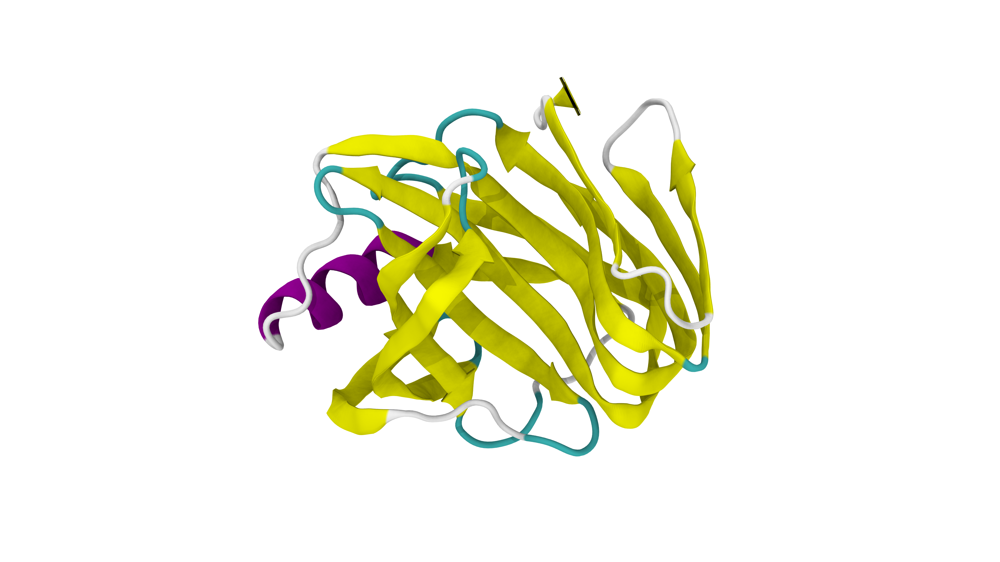
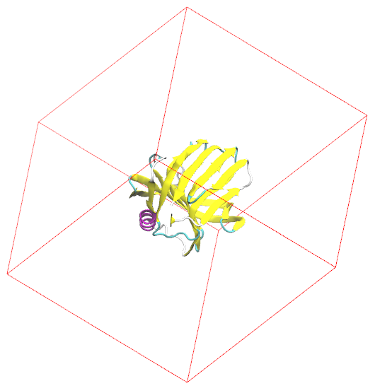
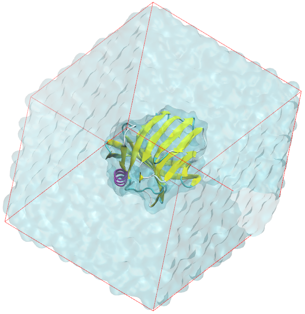
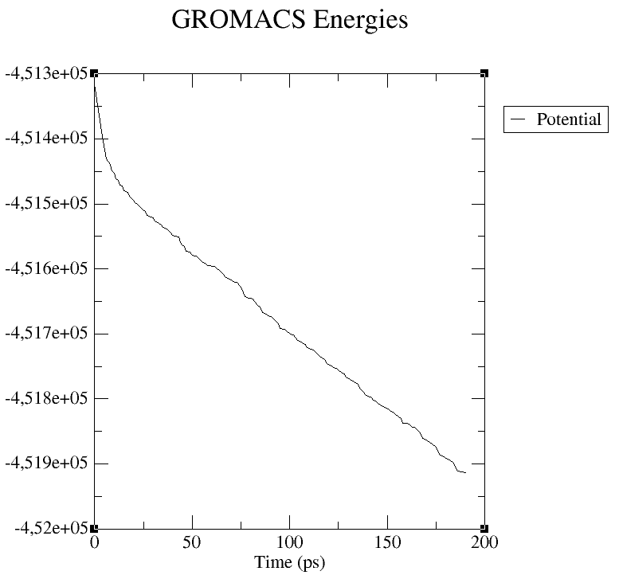
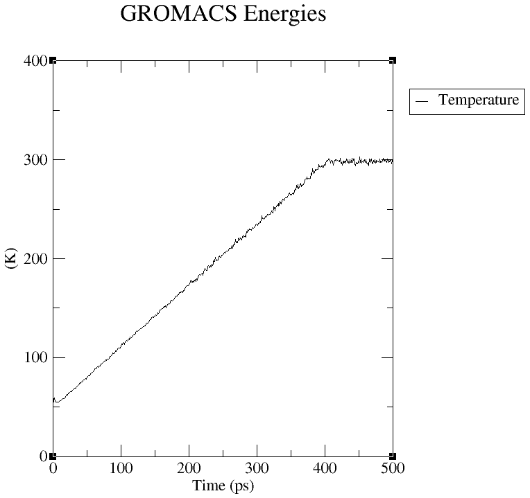
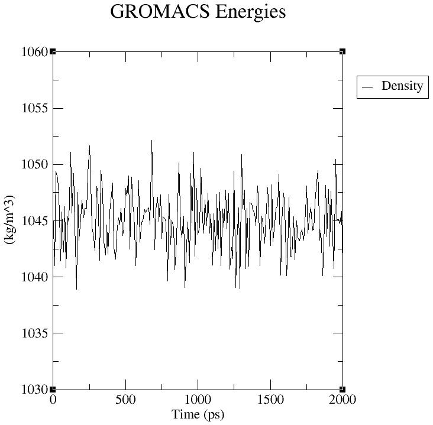

# Dinâmica Molecular Clássica não enviesada Xilanase

!!! warning "Atenção!"
    Página em reformulação.

O objetivo deste tutorial é simular uma biomolécula em caixa periódica com água a 298,15 K e 1 bar, sem potenciais de viés, e obter resultados estatisticamente defensáveis.

Três decisões distinguem uma trajetória que apenas executa de uma trajetória com significado físico:

1. **Como preparar o sistema?** Em dez etapas, e não em três, liberando os graus de liberdade na ordem em que relaxam.
2. **Como determinar o fim da equilibração?** Por um critério numérico, e não pela inspeção visual da curva de densidade.
3. **Quantas simulações realizar?** Uma única trajetória, por mais longa que seja, não permite estimar a própria incerteza.

!!! info "Por que dez etapas?"

    * O solvente se reorganiza em picossegundos; as cadeias laterais, em centenas de picossegundos; a estrutura secundária, em nanossegundos.

    * A remoção simultânea de todas as restrições faz com que a energia liberada no relaxamento de contatos estéricos se dissipe deformando a vizinhança. As restrições escalonadas evitam esse efeito: mantêm fixos os graus de liberdade lentos enquanto os rápidos relaxam, e são reduzidas progressivamente.

    * O custo adicional é da ordem de poucos nanossegundos por réplica, desprezível diante de uma produção de centenas de nanossegundos.


Explore, colabore e estude! :lucide-smile: Dúvidas: [patrick.faustino@unesp.br](mailto:patrick.faustino@unesp.br)

---
## :lucide-download: Arquivos iniciais

Utilize a estrutura da **xilanase** de código [1XNB](https://www.rcsb.org/structure/1XNB) no PDB, resolvida a 1,49 Å. **Dê preferência a estruturas com resolução cristalográfica inferior a 2,5 Å**, que fornecem geometria mais confiável e detalhada, fundamental para a qualidade da simulação. Estruturas preditas também podem ser obtidas no [AlphaFold](https://alphafold.ebi.ac.uk/).

A preparação da estrutura cristalográfica é uma etapa crítica antes de simulações ou de docagem. A reconstrução de resíduos ausentes, com bibliotecas como o [Modeller](https://salilab.org/modeller/) ou servidores como o [SWISS-MODEL](https://swissmodel.expasy.org/), evita lacunas na cadeia polipeptídica e preserva sua integridade física.

Também é necessário atribuir o estado de protonação dos resíduos tituláveis, com o servidor [H++](http://newbiophysics.cs.vt.edu/H++/) ou com ferramentas de linha de comando como o [PROPKA](https://github.com/jensengroup/propka). Estados de protonação incorretos alteram as cargas atribuídas e, consequentemente, as interações eletrostáticas, a rede de ligações de hidrogênio e a estabilidade conformacional do sistema.

- Para download do arquivo PDB utilizado: [1XNB_protonated](../assets/dinamica/1XNB_protonated.pdb).
- Para download dos arquivos inputs `.mdp`: [inputs](https://github.com/patrickallanfaustino/patrickallanfaustino.github.io/tree/main/docs/assets/dinamica/inputs).

!!! note "Dica:"
    Desenvolvi um notebook para realizar esses ajustes na molécula. Faça o download dos arquivos e configure o notebook para o seu sistema.
    [](https://colab.research.google.com/github/patrickallanfaustino/patrickallanfaustino.github.io/blob/main/docs/assets/notebooks/protein_builder.ipynb)

<div align="center">
    
</div>

>Xilanase, 1XNB. O VMD (*Visual Molecular Dynamics*) possui esquema de cores para estruturas de biomoléculas: 🟣 violeta para alfa-hélices; 🟡 amarelo para beta-folhas; 🔵 azul para hélices 3₁₀; 🔵 ciano para voltas e ⚪ branco para novelos ou cordas.


---
## :lucide-atom: Preparo da topologia da molécula: campos de forças

O arquivo **1XNB.pdb** contém, além das coordenadas da biomolécula, moléculas de água (`HOH`) e outros ligantes (`HETATM`). Remova esses componentes para evitar erros nas etapas seguintes, editando o arquivo manualmente ou com os comandos a seguir:

```bash
grep -v HETATM 1XNB.pdb > 1XNB_clean.pdb    # remove ligantes e água

grep -v HOH 1XNB.pdb > 1XNB_clean.pdb       # remove apenas a água
```

Algumas biomoléculas apresentam múltiplas cadeias, identificadas como `chain A`, `chain B` e assim por diante. Defina a(s) cadeia(s) que serão estudadas.

Após a limpeza, ajuste os estados de protonação dos resíduos, de modo que a biomolécula tenha o estado de carga adequado ao pH de interesse.

Em seguida, gere a topologia, escolhendo o campo de força e o modelo de água. Escolha ff19SB + OPC, se possível:

```bash
gmx pdb2gmx -v -f 1XNB_clean.pdb -o xilanase.gro -ignh

# -v = verbose, exibe o andamento do processo.
# -f = arquivo de entrada com as coordenadas.
# -o = arquivo de saída com as coordenadas.
# -ignh = ignora hidrogênios já presentes no arquivo de entrada.
```

!!! note "Dica:"

    Para utilizar um campo de força externo, coloque a pasta correspondente no diretório de trabalho com o nome `<nome>.ff`.


Sem informação adicional, o `pdb2gmx` atribui estados de protonação canônicos a cada aminoácido (pH próximo de 7) e adiciona os hidrogênios correspondentes. Ao final, confira a carga líquida da biomolécula na mensagem `Total charge in system X.000 e`.

Para visualizar no VMD, utilize:

```bash
vmd xilanase.gro
```

!!! note "Nota:"

    Saiba mais sobre [pdb2gmx](https://manual.gromacs.org/documentation/current/onlinehelp/gmx-pdb2gmx.html).

    Serão criados os arquivos:

    - `xilanase.gro`: coordenadas iniciais de cada átomo, com a nomenclatura do campo de força escolhido.

    - `topol.top`: topologia do sistema, com os parâmetros de interação do campo de força.

    - `posre.itp`: topologia auxiliar com as restrições de posição padrão dos átomos pesados.

| Campo de força | Informações | Modelo de água | Interações não ligadas | Referências |
|---|---|---|---|---|
| **OPLS-AA** | Átomo explícito, desenvolvido por Jorgensen para fases condensadas: proteínas, pequenas moléculas e solventes orgânicos (lipídios: variante L-OPLS). A versão mais recente é a OPLS-AA/M, distribuída pelo grupo de Jorgensen também em formato GROMACS; o `oplsaa.ff` do GROMACS é a OPLS-AA/L. | TIP4P (recomendado no `pdb2gmx`); TIP3P também é usado. | `rvdw` 1.0–1.2 nm, PME, `DispCorr = EnerPres` | [Jorgensen et al. 1996](https://doi.org/10.1021/ja9621760)<br>[Robertson et al. 2015](https://doi.org/10.1021/acs.jctc.5b00356) (OPLS-AA/M)<br>[Siu et al. 2012](https://doi.org/10.1021/ct200908r) (L-OPLS) |
| **AMBER** | Proteínas e ácidos nucleicos. O GROMACS traz nativamente amber99sb-ildn, amber14sb e amber19sb, entre outros. Para DNA e RNA, o AMBER recomenda OL15 e OL3. Pequenas moléculas: GAFF/GAFF2 via ACPYPE. | Depende da versão: TIP3P para ff99SB-ILDN e ff14SB; OPC ou OPC3 para ff19SB. | `rvdw` 0.8–1.0 nm (até 1.2 nm), PME, `DispCorr = EnerPres` | [Lindorff-Larsen et al. 2010](https://doi.org/10.1002/prot.22711) (ff99SB-ILDN)<br>[Maier et al. 2015](https://doi.org/10.1021/acs.jctc.5b00255) (ff14SB)<br>[Tian et al. 2020](https://doi.org/10.1021/acs.jctc.9b00591) (ff19SB)<br>[Zgarbová et al. 2015](https://doi.org/10.1021/acs.jctc.5b00716) (OL15)<br>[Zgarbová et al. 2011](https://doi.org/10.1021/ct200162x) (OL3)<br>[Wang et al. 2004](https://doi.org/10.1002/jcc.20035) (GAFF)<br>[Sousa da Silva & Vranken 2012](https://doi.org/10.1186/1756-0500-5-367) (ACPYPE) |
| **CHARMM36/36m** | Átomo explícito; muito detalhado para lipídios, proteínas (C36m) e carboidratos; pequenas moléculas via CGenFF. Port mais recente para GROMACS: fev/2026 (laboratório MacKerell), em versão *force-switch* (`charmm36-feb2026_cgenff-5.0.ff`, padrão) e LJ-PME (`charmm36-feb2026_ljpme_cgenff-5.0.ff`). | TIP3P do CHARMM (com LJ nos H); não substituir pelo TIP3P original. | *Force-switch*: 1.0→1.2 nm, PME com `rcoulomb = 1.2`, `DispCorr = no` em bicamadas. LJ-PME: PME para Coulomb e LJ, corte de 0.9 nm. | [Best et al. 2012](https://doi.org/10.1021/ct300400x) (C36)<br>[Huang et al. 2017](https://doi.org/10.1038/nmeth.4067) (C36m)<br>[Klauda et al. 2010](https://doi.org/10.1021/jp101759q) (lipídios)<br>[Yu et al. 2021](https://doi.org/10.1021/acs.jctc.0c01326) (LJ-PME)<br>[Vanommeslaeghe et al. 2010](https://doi.org/10.1002/jcc.21367) (CGenFF)<br>[MacKerell et al. 1998](https://doi.org/10.1021/jp973084f) (CHARMM22) |
| **GROMOS (54A7)** | Átomo unido: H alifáticos incorporados aos carbonos. Parametrizado contra energias livres de hidratação e solvatação (53A6/54A7). O GROMACS traz 43a1, 43a2, 45a3, 53a5, 53a6 e 54a7. | SPC | Parametrizado com *twin-range* 0.8/1.4 nm e campo de reação (εRF ≈ 62). No GROMACS atual: corte único de 1.4 nm com campo de reação ou PME; o manual alerta que propriedades como a densidade podem diferir. | [Oostenbrink et al. 2004](https://doi.org/10.1002/jcc.20090) (53A5/53A6)<br>[Schmid et al. 2011](https://doi.org/10.1007/s00249-011-0700-9) (54A7)<br>[Tironi et al. 1995](https://doi.org/10.1063/1.469273) (campo de reação) |

| Modelo | Sítios | Descrição | Referências |
|---|---|---|---|
| **SPC** | 3 | Rígido; O–H = 1.0 Å e ângulo tetraédrico de 109.47°. Ajustado à densidade e à energia de vaporização do líquido. Água de referência do GROMOS. | [Berendsen et al. 1981](https://doi.org/10.1007/978-94-015-7658-1_21) |
| **SPC/E** | 3 | SPC reparametrizado com cargas maiores, incluindo na parametrização uma correção pela energia de autopolarização. Melhora densidade e difusão em relação ao SPC. | [Berendsen et al. 1987](https://doi.org/10.1021/j100308a038) |
| **TIP3P** | 3 | Rígido, geometria experimental (0.9572 Å; 104.52°). Padrão do ff14SB; o CHARMM usa versão modificada com LJ nos H. Barato, mas superestima a difusão e subestima a viscosidade. | [Jorgensen et al. 1983](https://doi.org/10.1063/1.445869) |
| **TIP4P** | 4 | Carga negativa num sítio virtual (M) na bissetriz HOH; o oxigênio guarda só o LJ. Variantes: TIP4P-Ew (Ewald), TIP4P/2005 (diagrama de fases), TIP4P/Ice. | [Jorgensen et al. 1983](https://doi.org/10.1063/1.445869)<br>[Horn et al. 2004](https://doi.org/10.1063/1.1683075) (TIP4P-Ew)<br>[Abascal & Vega 2005](https://doi.org/10.1063/1.2121687) (TIP4P/2005)<br>[Abascal et al. 2005](https://doi.org/10.1063/1.1931662) (TIP4P/Ice) |
| **OPC** | 4 | Rígido, 4 pontos e 3 cargas, otimizado para reproduzir um conjunto de propriedades do líquido. Recomendado com ff19SB; custo semelhante ao de outros modelos de 4 pontos. | [Izadi et al. 2014](https://doi.org/10.1021/jz501780a) |
| **OPC3** | 3 | Versão de 3 pontos da mesma abordagem; mais preciso que TIP3P e SPC/E nas propriedades do líquido, com o custo de um modelo de 3 pontos. | [Izadi & Onufriev 2016](https://doi.org/10.1063/1.4960175) |
| **TIP5P** | 5 | Duas cargas negativas em sítios virtuais nos pares isolados do O. Reproduz o máximo de densidade perto de 4 °C; mais caro. Com PME, preferir o TIP5P-E. | [Mahoney & Jorgensen 2000](https://doi.org/10.1063/1.481505)<br>[Rick 2004](https://doi.org/10.1063/1.1652434) (TIP5P-E) |

!!! warning "Atenção!"

    Escolha o campo de força e o modelo de água com base na natureza do sistema e nas propriedades que serão investigadas.

    É fundamental conhecer os formatos de arquivo utilizados pelo GROMACS. Consulte: [File formats topology](https://manual.gromacs.org/current/reference-manual/topologies/topology-file-formats.html) e [File formats](https://manual.gromacs.org/current/reference-manual/file-formats.html).

---
## :lucide-box: Definindo a caixa de simulação: dimensões, solvatação e neutralização

Nesta etapa, definem-se as dimensões da caixa de simulação, adicionam-se as moléculas de água (solvente) e neutraliza-se o sistema.

```bash
gmx editconf -f xilanase.gro -o box.gro -c -d 1.2 -bt dodecahedron

# -c = centraliza a biomolécula na caixa.
# -d = distância mínima, em nm, entre o soluto e as faces da caixa.
# -bt = box type, formato da caixa.
```

Escolha o formato da caixa (`cubic`, `triclinic`, `octahedron` ou `dodecahedron`) de acordo com a geometria da biomolécula. Para solutos aproximadamente globulares, o `dodecahedron` exige cerca de 71 % do volume de uma caixa cúbica com a mesma distância mínima entre imagens periódicas, o que reduz o número de moléculas de água e o custo computacional.

Verifique as dimensões da caixa na saída do programa. A distância mínima entre a biomolécula e as faces da caixa deve estar **entre 1,0 e 2,0 nm**, de modo que o soluto não interaja com as próprias imagens periódicas.

!!! note "Nota:"

    Saiba mais sobre [editconf](https://manual.gromacs.org/documentation/current/onlinehelp/gmx-editconf.html).

    As opções `-d` e `-box` são formas alternativas de dimensionar a caixa. Com `-box`, as arestas são fixadas explicitamente; por exemplo, `-bt cubic -box 10 10 10` gera uma caixa cúbica de 10 nm de aresta, cabendo ao usuário verificar se a margem em torno do soluto é suficiente. Com `-d`, o GROMACS calcula as dimensões a partir da maior extensão do soluto acrescida da distância especificada, o que garante a margem mínima sem volume excedente. Não combine as duas opções.


<div align="center">
    
</div>

Para visualizar no VMD:

```bash
vmd box.gro

# Extensions > Tk Console > pbc box -color red
```

---
### :lucide-droplets: Solvatação

Em seguida, preencha a caixa com moléculas de água para solvatar a xilanase, de modo que a biomolécula fique imersa em meio aquoso.

```bash
gmx solvate -cp box.gro -cs tip4p.gro -o solvated.gro -p topol.top

# -cp = coordenadas do soluto (geralmente, a proteína).
# -cs = coordenadas do solvente.
# -p = topologia do sistema, atualizada com o número de moléculas de solvente.
```

O GROMACS preenche a caixa com moléculas de água a partir do arquivo `tip4p.gro`, que contém uma caixa pré-equilibrada de água com 4 sítios, e as identifica como o resíduo **SOL**. Confira a quantidade de solvente adicionado na linha `Number of solvent molecules` da saída. Essa informação é atualizada automaticamente na seção `[ molecules ]` do arquivo `topol.top`.

!!! note "Nota:"

    Saiba mais sobre [solvate](https://manual.gromacs.org/documentation/current/onlinehelp/gmx-solvate.html).

    Para modelos de água de 3 sítios, utilize `-cs spc216.gro`.


<div align="center">
    
</div>

### :lucide-scale: Neutralização
A etapa final da preparação da caixa é a adição de íons. Com o somatório de Ewald (PME), um sistema com carga líquida recebe implicitamente um fundo de carga uniforme que o neutraliza, o que pode introduzir artefatos nas energias e na estrutura. Por isso, o sistema é neutralizado com contraíons explícitos.

Antes de executar o `genion`, gere um arquivo binário `.tpr` com as informações do sistema:

```bash
gmx grompp -v -f inputs/ions.mdp -o ions.tpr -c solvated.gro -p topol.top

# -f = arquivo de parâmetros (.mdp).
# -c = coordenadas do sistema.
```

A opção `-f` indica o arquivo [ions.mdp](../assets/dinamica/inputs/ions.mdp), da pasta `inputs/`, que contém os parâmetros desta etapa. Recomenda-se o estudo detalhado das [opções dos arquivos .mdp](https://manual.gromacs.org/current/user-guide/mdp-options.html).

!!! note "Nota:"

    Saiba mais sobre [grompp](https://manual.gromacs.org/documentation/current/onlinehelp/gmx-grompp.html).

    O `grompp` pode emitir avisos (`warnings`), que devem ser analisados um a um. Somente após confirmar que um aviso não compromete a simulação, suprima-o com `-maxwarn x`, em que `x` é o número de avisos a serem ignorados.


O `genion` solicitará o grupo de moléculas que será substituído pelos íons. Selecione o grupo do solvente (**SOL**), digitando o número correspondente.

Adicione os íons para neutralizar o sistema e atingir a concentração salina desejada:

```bash
gmx genion -s ions.tpr -o neutralized.gro -p topol.top -pname NA -nname CL -neutral -conc 0.15

# -s = arquivo de entrada da simulação (.tpr) gerado na etapa anterior.
# -pname = nome do cátion, neste caso sódio (NA).
# -nname = nome do ânion, neste caso cloreto (CL).
# -neutral = adiciona contraíons até neutralizar a carga líquida.
# -conc = concentração salina, em mol/L.
```

Sem as opções `-neutral`, `-conc`, `-np` ou `-nn`, o `genion` não adiciona íons. A opção `-neutral` neutraliza a carga líquida, e `-conc 0.15` acrescenta NaCl até 0,15 mol/L, concentração próxima à fisiológica (≈ 0,9 % m/v).

A saída informa `Will try to add XX NA ions and XX CL ions`, com o número de íons adicionados. O arquivo `topol.top` é atualizado com essas quantidades.


!!! note "Nota:"

    Saiba mais sobre [genion](https://manual.gromacs.org/documentation/current/onlinehelp/gmx-genion.html).


---
## :lucide-vibrate: Restrições de posição
As restrições de posição mantêm os átomos da biomolécula próximos de suas posições de referência durante as etapas iniciais. Elas são definidas em arquivos `.itp`, que indicam os átomos restringidos e a constante de força do potencial harmônico aplicado a cada um.

A minimização e as etapas de ajuste de temperatura e pressão são realizadas de forma escalonada. Inicialmente, a biomolécula permanece fortemente restringida, e apenas a água e os íons relaxam. As restrições são então reduzidas progressivamente, permitindo que a biomolécula se acomode ao solvente.

```bash
gmx make_ndx -f neutralized.gro -o index.ndx

gmx genrestr -f neutralized.gro -n index.ndx -o posre_bb.itp -fc 1000 1000 1000    # Escolha 'MainChain'

gmx genrestr -f neutralized.gro -n index.ndx -o posre_sc.itp -fc 1000 1000 1000    # Escolha 'SideChain-H'
```

Esses comandos geram dois arquivos de restrição: `posre_bb.itp`, para os átomos da cadeia principal (*backbone*), e `posre_sc.itp`, para os átomos pesados das cadeias laterais (*side chains*). O valor de 1000 kJ mol⁻¹ nm⁻² é apenas provisório: ele será substituído por variáveis, para que a constante de força possa ser ajustada em cada etapa.

```bash
awk '($1 ~ /^[0-9]+$/ && NF == 5) {printf "%6s %5s %14s %14s %14s\n", $1, $2, "POSRES_FC_BB", "POSRES_FC_BB", "POSRES_FC_BB"; next} {print}' posre_bb.itp > tmp && mv tmp posre_bb.itp

awk '($1 ~ /^[0-9]+$/ && NF == 5) {printf "%6s %5s %14s %14s %14s\n", $1, $2, "POSRES_FC_SC", "POSRES_FC_SC", "POSRES_FC_SC"; next} {print}' posre_sc.itp > tmp && mv tmp posre_sc.itp
```

Verifique se, em `posre_bb.itp` e `posre_sc.itp`, o valor `1000` foi substituído pelas variáveis `POSRES_FC_BB` e `POSRES_FC_SC`, respectivamente. Essas variáveis são definidas na diretiva `define` de cada arquivo `.mdp`, o que permite reduzir as restrições etapa a etapa.

Por fim, inclua `posre_bb.itp` e `posre_sc.itp` no arquivo `topol.top`, para que o GROMACS aplique as restrições durante a simulação.

---
## :lucide-trending-down: Minimização do sistema

A etapa seguinte é a minimização de energia, que remove contatos estéricos desfavoráveis e leva o sistema a um mínimo local de energia potencial antes da dinâmica. Cada etapa consiste em gerar um arquivo `.tpr` com o `grompp` e executá-lo com o `mdrun`.

A minimização é escalonada: as três primeiras etapas restringem a biomolécula com constantes de força decrescentes, de modo que o solvente e os íons relaxem primeiro. A última etapa é realizada sem restrições.

| Etapa | Cadeia principal (kJ mol⁻¹ nm⁻²) | Cadeias laterais (kJ mol⁻¹ nm⁻²) |
|---|---|---|
| [em1_rest](../assets/dinamica/inputs/em1_rest.mdp) | 2100 | 2100  |
| [em2_rest](../assets/dinamica/inputs/em2_rest.mdp) | 800 | 800  |
| [em3_rest](../assets/dinamica/inputs/em3_rest.mdp) | 40 | 40  |
| [em4_free](../assets/dinamica/inputs/em4_free.mdp) | 0 | 0  |

```bash
gmx grompp -v -f inputs/em1_rest.mdp -c neutralized.gro -r neutralized.gro -p topol.top -o em1.tpr
gmx mdrun -v -deffnm em1

gmx grompp -v -f inputs/em2_rest.mdp -c em1.gro -r neutralized.gro -p topol.top -o em2.tpr
gmx mdrun -v -deffnm em2

gmx grompp -v -f inputs/em3_rest.mdp -c em2.gro -r neutralized.gro -p topol.top -o em3.tpr
gmx mdrun -v -deffnm em3

gmx grompp -v -f inputs/em4_free.mdp -c em3.gro -r neutralized.gro -p topol.top -o em4.tpr
gmx mdrun -v -deffnm em4

# -r = coordenadas de referência para as restrições de posição.
# -deffnm = define o nome padrão dos arquivos de entrada e saída.
```

O `mdrun` é o programa que executa a minimização e a dinâmica no GROMACS. A opção `-deffnm` padroniza os nomes dos arquivos de entrada e saída; o nome usado em `grompp -o <nome>.tpr` deve ser o mesmo informado em `-deffnm`.

!!! note "Nota:"

    Saiba mais sobre [mdrun](https://manual.gromacs.org/documentation/current/onlinehelp/gmx-mdrun.html).


Avalie a minimização pela energia potencial da última etapa. Para isso, extraia os dados do arquivo de energia (`.edr`) para um arquivo gráfico (`.xvg`) e verifique se a energia potencial atingiu um patamar. Confira também, na saída do `mdrun`, se a força máxima (`Fmax`) ficou abaixo do critério `emtol` definido no `.mdp`.

```bash
gmx energy -f em4.edr -s em4.tpr -o potential.xvg

xmgrace potential.xvg
```

Quando solicitado, digite o número correspondente a `Potential`, seguido de um espaço e de 0 (zero) para encerrar a seleção. Exemplo: `11 0`.

!!! note "Nota:"

    Saiba mais sobre [energy](https://manual.gromacs.org/documentation/current/onlinehelp/gmx-energy.html).

<div align="center">
    
</div>

---
## :lucide-sliders-horizontal: Equilíbrio NVT e NPT: termostatos e barostatos

Após a minimização, o sistema é levado a 298,15 K e 1 bar por meio de seis etapas curtas, adaptadas do protocolo de [Roe e Brooks (2020)](https://doi.org/10.1063/5.0013849): aquecimento gradual em NVT, seguido de redução progressiva das restrições de posição em NPT. A ordem de liberação acompanha a hierarquia dos tempos de relaxação: solvente e íons, cadeias laterais e, por último, esqueleto. As constantes de força foram convertidas de kcal mol⁻¹ Å⁻² para kJ mol⁻¹ nm⁻² (fator 418,4).

| Etapa | Arquivo | Ensemble | dt | Duração | k<sub>esqueleto</sub> | k<sub>cadeias laterais</sub> |
|:-----:|---------|----------|:--:|:-------:|------------:|------------:|
| 1 | [nvt1_heat.mdp](../assets/dinamica/inputs/nvt1_heat.mdp) | NVT, 50 → 298,15 K | 1 fs | 500 ps | 2100 | 2100 |
| 2 | [nvt2_hold.mdp](../assets/dinamica/inputs/nvt2_hold.mdp) | NVT, 298,15 K | 2 fs | 200 ps | 800 | 800 |
| 3 | [npt1.mdp](../assets/dinamica/inputs/npt1.mdp) | NPT | 2 fs | 500 ps | 400 | 400 |
| 4 | [npt2.mdp](../assets/dinamica/inputs/npt2.mdp) | NPT | 2 fs | 500 ps | 200 | 200 |
| 5 | [npt3.mdp](../assets/dinamica/inputs/npt3.mdp) | NPT | 2 fs | 500 ps | 200 | 0 |
| 6 | [npt4.mdp](../assets/dinamica/inputs/npt4.mdp) | NPT | 2 fs | 2 ns | — | — |

Constantes de força em kJ mol⁻¹ nm⁻². Parâmetros comuns: V-rescale (`tc-grps = System`, `tau-t = 1.0` ps, `ref-t = 298.15` K) e, nas etapas NPT, C-rescale isotrópico (`tau-p = 2.0` ps, `ref-p = 1.0` bar, `compressibility = 4.5e-5` bar⁻¹).


### :lucide-copy: Réplicas e sementes
 
Por ser a dinâmica molecular intrinsecamente caótica, a incerteza de um observável só pode ser estimada a partir de um conjunto de réplicas independentes; uma trajetória longa não substitui esse conjunto [Wan; Sinclair; Coveney, 2021](https://doi.org/10.1098/rsta.2020.0082), [Knapp; Ospina; Deane, 2018](https://doi.org/10.1021/acs.jctc.8b00391). Este tutorial emprega 5 réplicas de 300 ns.
 
A minimização é determinística e compartilhada. As réplicas divergem em `nvt1_heat.mdp`, única etapa com `gen-vel = yes`. As sementes são explícitas, para que o protocolo seja reconstruível, e adotou-se a regra **3000 + 100 × réplica + etapa**: `gen-seed` = base + 1 e `ld-seed` = base + 2 (NVT1) até base + 8 (produção). O `ld-seed` também é relevante, pois V-rescale e C-rescale são estocásticos. Faça as alterações manualmente no arquivo `.mdp`.

!!! danger "Verificação obrigatória"
 
    Sementes idênticas entre diretórios produzem réplicas idênticas, sem qualquer mensagem de erro. Evite `gen-seed = -1`, que garante independência, mas impede a reconstrução do protocolo para publicação.


### :lucide-thermometer: NVT1: aquecimento
 
A temperatura é elevada linearmente de 50 K a 298,15 K em 400 ps (≈ 0,62 K ps⁻¹), seguida de 100 ps de patamar, por *simulated annealing*:
 
```
dt                = 0.001
tau-t             = 0.5
annealing         = single
annealing-npoints = 2
annealing-time    = 0    400
annealing-temp    = 50   298.15
gen-vel           = yes
gen-temp          = 50
```
 
`gen-temp` deve coincidir com a primeira temperatura da rampa; caso contrário, as velocidades são geradas já na temperatura final e o termostato resfria o sistema antes de reaquecê-lo. O `tau-t` reduzido (0,5 ps) permite ao termostato acompanhar a rampa, e o passo de 1 fs acomoda as forças ainda elevadas.

 
```bash
gmx grompp -v -f inputs/nvt1_heat.mdp -c em4.gro -r em4.gro -p topol.top -o nvt1.tpr
gmx mdrun -v -deffnm nvt1

gmx energy -f nvt1.edr -o qc_temperatura.xvg     # Temperature
xmgrace qc_temperatura.xvg
```

<div align="center">
    
</div>

A temperatura deve acompanhar a rampa nominal e flutuar em torno de 298,15 K no patamar. Um salto inicial indica `gen-temp` incorreto; um atraso sistemático, `tau-t` excessivo.


### :lucide-gauge: NVT2 a NPT3: estabilização e liberação das restrições
 
A partir da NVT2, `gen-vel = no` e `continuation = yes`, e cada etapa parte do *checkpoint* anterior (`-t`), que preserva posições, velocidades e estado dos acopladores em precisão total. Na NPT1, o barostato é ativado e a caixa ajusta seu volume; na NPT3, as cadeias laterais são liberadas enquanto o esqueleto permanece restrito.
 
```bash
gmx grompp -v -f inputs/nvt2_hold.mdp -c nvt1.gro -r em4.gro -t nvt1.cpt -p topol.top -o nvt2.tpr
gmx mdrun -v -deffnm nvt2
 
gmx grompp -v -f inputs/npt1.mdp -c nvt2.gro -r em4.gro -t nvt2.cpt -p topol.top -o npt1.tpr
gmx mdrun -v -deffnm npt1
 
gmx grompp -v -f inputs/npt2.mdp -c npt1.gro -r em4.gro -t npt1.cpt -p topol.top -o npt2.tpr
gmx mdrun -v -deffnm npt2
 
gmx grompp -v -f inputs/npt3.mdp -c npt2.gro -r em4.gro -t npt2.cpt -p topol.top -o npt3.tpr
gmx mdrun -v -deffnm npt3
```
 
### :lucide-unlock: NPT4: equilibração livre e critério de parada
 
A última etapa é realizada sem restrições, nas mesmas condições da produção:
 
```bash
gmx grompp -v -f inputs/npt4.mdp -c npt3.gro -t npt3.cpt -p topol.top -o npt4.tpr
gmx mdrun -v -deffnm npt4

gmx energy -f npt4.edr -o qc_densidade.xvg       # Density
gmx energy -f npt4.edr -o qc_pressao.xvg         # Pressure
```
 
A pressão instantânea flutua centenas de bar; avalia-se apenas se sua média é compatível com 1 bar dentro da estimativa de erro (`Err.Est.`). O critério de equilíbrio é a densidade, avaliada objetivamente segundo [Roe e Brooks (2020)](https://doi.org/10.1063/5.0013849).

<div align="center">
    
</div>

| Algoritmo | Tipo | Ensemble correto | Observação |
|-----------|------|:----------------:|------------|
| Berendsen | termostato / barostato | Não | Suprime flutuações; não recomendado pela documentação do GROMACS |
| V-rescale | termostato | Sim | Estocástico, robusto fora do equilíbrio [Bussi; Donadio; Parrinello, 2007](https://doi.org/10.1063/1.2408420) |
| Nosé-Hoover | termostato | Sim | Determinístico; oscila longe da temperatura-alvo |
| Parrinello-Rahman | barostato | Sim | Oscila e pode instabilizar se iniciado fora do equilíbrio |
| C-rescale | barostato | Sim | Estocástico, estável desde a primeira etapa NPT; disponível desde o GROMACS 2021 [Bernetti; Bussi, 2020](https://doi.org/10.1063/5.0020514) |


A combinação V-rescale + C-rescale, recomendada pela documentação do GROMACS, permite usar os mesmos algoritmos na equilibração e na produção. Valores usuais de `tau-t` situam-se entre 0,1 e 1,0 ps; de `tau-p`, entre 1 e 5 ps para o C-rescale. Adotar `tau-p` maior que `tau-t` é prática comum, não exigência do algoritmo.

---
## :lucide-play: Produção: integradores
 
Concluída e aprovada a equilibração em todas as réplicas, a simulação de produção é realizada sem restrições de posição, de modo que a dinâmica da proteína resulte exclusivamente do campo de força, do solvente e do acoplamento termodinâmico. Neste tutorial, cada uma das 5 réplicas é simulada por 300 ns no ensemble NPT, nas mesmas condições da NPT4.

### :lucide-file-cog: Parâmetros
 
Os principais parâmetros de [md.mdp](../assets/dinamica/inputs/md.mdp) são:
 
| Parâmetro | Valor | Justificativa |
|-----------|-------|---------------|
| `integrator` | `md` | Leap-frog (Hockney; Goel; Eastwood, 1974) |
| `dt` / `nsteps` | 0,002 ps / 150 000 000 | 300 ns; passo de 2 fs viabilizado pelas restrições em ligações com hidrogênio |
| `constraints` | `h-bonds` (LINCS) | Remove as vibrações mais rápidas (Hess et al., 1997) |
| `coulombtype` / `rcoulomb` | PME / 1,0 nm | Eletrostática de longo alcance (Essmann et al., 1995) |
| `rvdw` / `dispcorr` | 1,0 nm / `EnerPres` | Correção de dispersão para energia e pressão |

 
A frequência de gravação determina o número de amostras disponíveis para a análise, mas quadros consecutivos são correlacionados. Por isso, a unidade estatística das análises é a réplica.


### :lucide-terminal: Execução
 
Em cada diretório de réplica:
 
```bash
gmx grompp -v -f inputs/md.mdp -c npt4.gro -t npt4.cpt -p topol.top -o md_300ns.tpr
gmx mdrun -v -deffnm md_300ns
```
 
O `mdrun` grava um *checkpoint* (`md_300ns.cpt`) a cada 15 min, intervalo ajustável com `-cpt` (em minutos). Em caso de interrupção, a simulação é retomada exatamente do último *checkpoint*, e os novos dados são anexados aos arquivos existentes:
 
```bash
gmx mdrun -v -deffnm md_300ns -cpi md_300ns.cpt
```
 
Ao final, confirme a integridade da trajetória e registre o desempenho:
 
```bash
gmx check -f md_300ns.xtc
grep Performance md_300ns.log
```

| Integrador | Algoritmo | Uso indicado | Limitações | Referência |
|------------|-----------|--------------|------------|------------|
| **`md`** | Leap-frog: posições e velocidades avaliadas em meios passos alternados | Produção e equilibração em solvente explícito | Velocidades defasadas meio passo em relação às posições | Hockney; Goel; Eastwood (1974) |
| **`md-vv`** | Velocity Verlet: posições e velocidades no mesmo instante | Integração reversível com Nosé-Hoover e MTTK; energia cinética em tempo completo | Custo ligeiramente maior; nem todas as funcionalidades de GPU disponíveis | Swope et al. (1982) |
| **`md-vv-avek`** | Velocity Verlet com energia cinética média dos dois meios passos | Equivalente ao `md-vv`, com energia cinética mais exata para acopladores | Mesmas do `md-vv`; requer termostato como os demais | Swope et al. (1982); Manual do GROMACS |
| **`sd`** | Dinâmica estocástica (Langevin) leap-frog: atrito e ruído atuam como termostato | Cálculos de energia livre alquímica; sistemas em que se deseja termostato local | O atrito altera propriedades dinâmicas (difusão, cinética) quando `tau-t` é pequeno | Goga et al. (2012) |
| **`bd`** | Dinâmica browniana (Langevin superamortecida): sem termo inercial | Solvente implícito e modelos de granulação grossa | Não descreve movimentos inerciais; inadequado para solvente explícito | Ermak; McCammon (1978) |
| **`steep`** | Máxima descida com passo adaptativo | Remoção de contatos ruins no início da preparação | Convergência lenta próximo ao mínimo | Manual do GROMACS |
| **`cg`** | Gradientes conjugados | Refinamento após `steep` (ex.: antes de análise de modos normais) | Não admite restrições de ligação, inclusive SETTLE (exige água flexível) | Hestenes; Stiefel (1952) |
| **`l-bfgs`** | Quasi-Newton de memória limitada | Minimização precisa de sistemas pequenos | Execução apenas serial no GROMACS | Liu; Nocedal (1989) |
 
!!! note "Escolha neste tutorial"
 
    Minimização com `steep` (EM1–EM4) e dinâmica com `md` em todas as etapas, acoplado a V-rescale e C-rescale. A combinação dispensa o integrador `sd` como termostato e mantém inalteradas as propriedades dinâmicas do solvente.


Para estender o tempo de uma simulação que já foi concluída, acrescentando mais tempo:
```bash
gmx convert-tpr -s md_300ns.tpr -extend 5000 -o md_305ns.tpr
gmx mdrun -v -deffnm md_305ns -cpi md_300ns.cpt -noappend

gmx trjcat -f md_300ns.xtc md_305ns.part0002.xtc -o final.xtc

# -extend = indica o tempo adicionado, em ps.
```

!!! note

    Saiba mais sobre [convert-tpr](https://manual.gromacs.org/current/onlinehelp/gmx-convert-tpr.html).


Link para visualizar o video demonstrativo da dinâmica: [https://youtu.be/ygxD4YCAXkQ?si=yOoxpgsyJHQ7fxu3](https://youtu.be/ygxD4YCAXkQ?si=yOoxpgsyJHQ7fxu3).

- [Figuras e video](md-visual.md)
- [Análises de resultados Xilanase](md-analysis.md)

---
## :lucide-file-text: Preprint e publicação relacionada

Este tutorial também serve como material suplementar do artigo
relacionado a esta dinâmica molecular.

!!! warning "Em construção"

    Preprint e publicação serão adicionados aqui assim que disponíveis.

## :lucide-quote: Como citar

FAUSTINO, P. A. S. *Documentação sobre Química Biofísica Computacional*. [S. l.]: Zenodo, 2026. DOI 10.5281/zenodo.22729510. Disponível em: <https://doi.org/10.5281/zenodo.22729510>.
